# 도움말 후속 — 목록 정렬, 자주 묻는 질문 카드, 그림과 자동 캡처

**작성**: 2026-11-27 · **상태**: 코드·자동 테스트·그림 캡처·빌드 완료(D156~D158). 앱 화면에서의 확인은 수동 검증으로 남음(§H) · **대상**: cli-manager-cr(DariTerm) · **Known issue**: 없음
**앞 문서**: [2026-11-27-17-help-panel.md](./2026-11-27-17-help-panel.md)(도움말 창) — **이 문서는 -17 을 적용한 상태를 기준으로 쓴다.**
**명세**: [spec/ui/help.md](../../spec/ui/help.md) §2·§5·§6·§7(이번에 고침)
**후속**: [2026-11-27-19-help-resize-image-viewer.md](./2026-11-27-19-help-resize-image-viewer.md) — 창 크기 조절, 그림 보기(이 문서 §4.3 의 "누르면 본문 안에서 실제 크기로 펼치기"를 앱 창 전체의 그림 보기로 바꿈, 문구 `help.imgShrink` 는 없앰), Esc 는 맨 위 겹만(D159). **이 문서를 적용한 뒤 -19 를 적용한다.** 이 문서의 코드·부록은 -18 시점 그대로다.
**첨부 그림**: [2026-11-27-18-help-sort-faq-images/img/](./2026-11-27-18-help-sort-faq-images/img/) — `ko/`·`en/` 각 12장(PNG 24개). md 에는 그림을 담을 수 없어 이 계획서 이름과 같은 폴더에 둔다. **적용할 때 §4.5 대로 `locales/help/img/` 를 만들어 옮긴다.**

---

## 0. 한 줄 요약

사용자 요청 세 가지를 넣었다.

1. "도움말 리스트를 지금의 기능 순서와 언어에 따라 가나다 또는 abc 순으로 정렬" → 목록 위에 **`[기능 순서] [가나다순]`** 단추(영어는 `A–Z`). 고른 순서를 기억한다. (D156)
2. "자주 묻는 질문이 각 질문별로 구분되게" → 본문 형식에 **`Q: 질문` + 답 줄** 묶음을 더하고 **카드**(Q·A 표시)로 그린다. 질문 6개 → 9개. (D157)
3. "권장안대로 그림 표시 기능과 자동 캡처 스크립트" → 본문 형식에 **``** 그림 줄, 그림은 `locales/help/img/<언어>/`. **`npm run help:capture`** 가 12화면 × ko·en = **24장**을 자동으로 찍는다. (D158)

작업 중 발견해 같이 고친 것: 서버 편집 > 자동화의 **로그인 스크립트 표에서 "기다릴 글자" 열이 한 글자 폭으로 줄어드는 문제**(-10 의 보관함 값 열 때문, §6).

## 1. 결정

| 항목 | 결정 | 까닭 |
|---|---|---|
| 정렬 단추 자리 | 검색 칸 바로 아래, 검색어가 **없을 때만**. 검색 중에는 그 자리에 결과 개수 줄 | 검색 결과는 맞은 정도 순이 더 쓸모 있다. 단추가 있어도 효과가 없으면 헷갈린다 |
| 이름순 기준 언어 | **보이는 본문의 언어**(대체 언어면 en) | 독일어 화면이면 영어 본문이 보이므로 영어 제목을 ABC 로 정렬해야 맞다 |
| 정렬 방법 | `Intl.Collator(locale, { numeric: true, sensitivity: 'base' })`, 꾸밈 기호를 뺀 제목. `tw` → `zh-TW`, 만들 수 없는 로캘이면 기본 로캘 | 한국어 가나다·영어 ABC 를 브라우저 규칙 그대로. 앱 언어 코드 `tw` 는 BCP 47 이 아니다 |
| 단추 문구 | ko 가나다순 · en/de/fr/es/pt A–Z · ru А–Я · ja 名前順 · zh 按名称 · tw 依名稱 | 사용자 말("가나다 또는 abc"). ja·zh·tw 는 지금 영어 본문이 보이므로 "이름순"으로 |
| 순서 기억 | 화면 저장소 `localStorage['dariterm.helpSort']` = `feature`/`name`. 읽기·쓰기 실패는 무시(기능 순서) | 동기화·백업할 값이 아닌 보기 편의. 명령 모음 비율(`dariterm.snippetRatio`)과 같은 방식 |
| FAQ 형식 | `Q: 질문` 줄 + 바로 아래 줄들(빈 줄·다음 `Q:`·항목 제목 전까지)이 한 묶음 → 블록 `{ kind: 'qa', q, a }` | `### 질문` 소제목으로도 나눌 수 있지만 카드가 질문 경계를 더 분명히 보인다. 형식이 단순해 번역하기 쉽다 |
| FAQ 화면 | 테두리·바탕 있는 카드, 위 파란 `Q` + 굵은 질문, 아래 회색 `A` + 답 | 질문마다 눈에 띄게 나뉜다 |
| 그림 형식 | 한 줄 전체가 ``, 파일 이름은 `[a-z0-9-]+\.(png|webp|jpg)` 만 | 경로(`../`)·하위 폴더를 막아 그림 폴더 밖을 가리킬 수 없게 |
| 그림 위치 | `locales/help/img/<언어>/<파일>`, 그 언어 → en → ko, 없으면 **그리지 않음** | 화면 글자가 언어마다 달라 언어별로 찍는다. 8개 언어는 영어 본문을 쓰므로 en 그림이 맞다. 캡처 전에 본문을 먼저 써도 깨지지 않게 |
| 그림 묶기 | `import.meta.glob(..., { eager: true, query: '?url', import: 'default' })` — 빌드 때 dist/assets 로 복사되어 exe 에 들어감 | 오프라인·사내망에서도 보인다 |
| 그림 보기 | 본문 폭·높이 360px 안, 누르면 실제 크기(다시 누르면 줄임), 아래 흐린 설명 | 창이 작아도 본문 흐름을 깨지 않게 |
| 그림 형식(파일) | PNG, 배율 1, 1280×820 창 | Playwright 가 PNG/JPEG 만 낸다. WebP 는 변환 도구가 더 필요. 24장 1.08MB 로 충분히 작다 |
| 테마 | 어두운 테마 하나로 찍음(`--theme light` 로 다시 찍을 수 있음) | 권장안. 테마별 그림은 2배 |
| 캡처 방식 | **vite 개발 서버 + 가짜 백엔드 + 이 PC 의 Edge(headless) + playwright-core** | 앱(WebView2)에 붙는 방법은 막혔다(§5.1). 화면 코드·CSS 는 앱과 같다 |
| 새 의존성 | `playwright-core@1.65.0`(개발 의존성, 버전 고정, 2026-11-05 배포) | 브라우저를 받지 않는다(Edge 사용). 앱 실행 파일에는 들어가지 않는다 |
| 호스트 변경 | 없음(Edge 는 Windows 기본 설치) | docs/host-settings 기록 대상이 아니다 |

## 2. 목록 정렬 (D156)

### 2.1 `frontend/src/lib/help.ts` — 추가한 것

`helpFor` 앞에 넣는다(전체 파일은 부록 A).

````ts
/** 목록 순서: 기능 순서(본문 파일의 순서) 또는 이름순(그 언어의 가나다·ABC). D156. */
export type HelpSort = 'feature' | 'name';

// 앱 언어 코드 → 정렬에 쓸 로캘. tw 는 BCP 47 코드가 아니라서 바꾼다.
const COLLATE_LOCALE: Record<string, string> = { tw: 'zh-TW' };

/** 항목을 고른 순서로. 이름순은 그 언어의 정렬 규칙(Intl.Collator), 숫자는 크기로. 원래 배열은 건드리지 않는다. */
export function sortTopics(topics: readonly HelpTopic[], sort: HelpSort, lang: string): HelpTopic[] {
  if (sort !== 'name') return [...topics];
  let coll: Intl.Collator;
  try {
    coll = new Intl.Collator(COLLATE_LOCALE[lang] ?? lang, { numeric: true, sensitivity: 'base' });
  } catch {
    coll = new Intl.Collator(undefined, { numeric: true, sensitivity: 'base' });
  }
  return [...topics].sort((a, b) => coll.compare(plainText(a.title), plainText(b.title)));
}

const SORT_KEY = 'dariterm.helpSort';

/** 마지막에 고른 순서(이 PC 의 화면 저장소). 읽을 수 없으면 기능 순서. */
export function loadHelpSort(): HelpSort {
  try {
    return globalThis.localStorage?.getItem(SORT_KEY) === 'name' ? 'name' : 'feature';
  } catch {
    return 'feature';
  }
}

export function saveHelpSort(sort: HelpSort): void {
  try {
    globalThis.localStorage?.setItem(SORT_KEY, sort);
  } catch {
    /* 저장 실패는 무시 — 다음에는 기능 순서 */
  }
}
````

### 2.2 `frontend/src/screens/HelpDialog.tsx` — 바뀐 곳

- `helpFor(lang)` 의 결과에서 `lang` 을 `bodyLang` 으로 받는다(실제로 보이는 본문 언어).
- `sort` 상태(처음 값 `loadHelpSort`), `setSort` 는 상태와 저장을 함께.
- `ordered = sortTopics(topics, sort, bodyLang)` — 검색어가 없을 때 목록과 "고른 항목이 목록에 없으면 첫 항목" 판단에 쓴다.
- 검색어가 없으면 상태 줄 자리에 `div.help-sort[role=group][aria-label=help.sort]` 와 단추 둘(`aria-pressed`).

before → after (diff, 앞은 -17 의 파일):

````diff
--- a/frontend/src/screens/HelpDialog.tsx
+++ b/frontend/src/screens/HelpDialog.tsx
@@ -3,7 +3,19 @@
 import { Fragment, useMemo, useState, type ReactNode } from 'react';
 import { CircleHelp, Search } from 'lucide-react';
 import { Modal } from '../ui/Modal';
-import { helpFor, markParts, searchHelp, searchTerms, type HelpBlock, type HelpTopic } from '../lib/help';
+import {
+  helpFor,
+  helpImage,
+  loadHelpSort,
+  markParts,
+  saveHelpSort,
+  searchHelp,
+  searchTerms,
+  sortTopics,
+  type HelpBlock,
+  type HelpSort,
+  type HelpTopic,
+} from '../lib/help';
 import { useUi } from '../state/ui';
 import { t, useLang } from '../i18n';
 
@@ -20,8 +32,32 @@ function Inline({ text, terms }: { text: string; terms: readonly string[] }) {
   return <>{out}</>;
 }
 
-function Block({ b, terms }: { b: HelpBlock; terms: readonly string[] }) {
+/** 도움말 그림. 누르면 실제 크기로 펼치고 다시 누르면 접는다. 그림 파일이 없으면 아무것도 그리지 않는다. */
+function Figure({ src, alt, lang, terms }: { src: string; alt: string; lang: string; terms: readonly string[] }) {
+  const [zoom, setZoom] = useState(false);
+  const url = helpImage(lang, src);
+  if (!url) return null;
+  return (
+    <figure className={`help-fig${zoom ? ' zoom' : ''}`}>
+      <button type="button" className="help-fig-btn" onClick={() => setZoom((z) => !z)} title={zoom ? t('help.imgShrink') : t('help.imgZoom')} aria-label={alt}>
+        
+      </button>
+      {alt && <figcaption className="faint small"><Inline text={alt} terms={terms} /></figcaption>}
+    </figure>
+  );
+}
+
+function Block({ b, terms, lang }: { b: HelpBlock; terms: readonly string[]; lang: string }) {
   switch (b.kind) {
+    case 'qa':
+      return (
+        <section className="help-qa">
+          <div className="help-q"><span className="help-q-mark" aria-hidden="true">Q</span><Inline text={b.q} terms={terms} /></div>
+          {b.a && <div className="help-a"><span className="help-q-mark a" aria-hidden="true">A</span><span><Inline text={b.a} terms={terms} /></span></div>}
+        </section>
+      );
+    case 'img':
+      return <Figure src={b.src} alt={b.alt} lang={lang} terms={terms} />;
     case 'h':
       return <h4><Inline text={b.text} terms={terms} /></h4>;
     case 'p':
@@ -49,11 +85,11 @@ function Block({ b, terms }: { b: HelpBlock; terms: readonly string[] }) {
   }
 }
 
-export function HelpBody({ topic, terms }: { topic: HelpTopic; terms: readonly string[] }) {
+export function HelpBody({ topic, terms, lang = 'en' }: { topic: HelpTopic; terms: readonly string[]; lang?: string }) {
   return (
     <article className="help-body selectable" aria-label={topic.title}>
       <h3><Inline text={topic.title} terms={terms} /></h3>
-      {topic.blocks.map((b, i) => <Block key={i} b={b} terms={terms} />)}
+      {topic.blocks.map((b, i) => <Block key={i} b={b} terms={terms} lang={lang} />)}
     </article>
   );
 }
@@ -62,14 +98,21 @@ export function HelpDialog() {
   const lang = useLang((s) => s.lang);
   const startTopic = useUi((s) => s.help.topic);
   const close = useUi((s) => s.closeHelp);
-  const { topics, fallback } = useMemo(() => helpFor(lang), [lang]);
+  // bodyLang: 실제로 보이는 본문의 언어(대체 언어면 en). 이름순 정렬과 그림 고르기에 쓴다.
+  const { topics, fallback, lang: bodyLang } = useMemo(() => helpFor(lang), [lang]);
   const [query, setQuery] = useState('');
   const [picked, setPicked] = useState<string | null>(startTopic);
+  const [sort, setSortState] = useState<HelpSort>(loadHelpSort);
+  const setSort = (s: HelpSort) => {
+    setSortState(s);
+    saveHelpSort(s);
+  };
   const terms = useMemo(() => searchTerms(query), [query]);
   const hits = useMemo(() => searchHelp(topics, query), [topics, query]);
+  const ordered = useMemo(() => sortTopics(topics, sort, bodyLang), [topics, sort, bodyLang]);
   const searching = terms.length > 0;
-  // 검색 중이면 맞은 항목 중에서, 아니면 전체에서 고른다. 고른 것이 목록에 없으면 첫 항목.
-  const listed = searching ? hits.map((h) => h.topic) : topics;
+  // 검색 중이면 맞은 항목 중에서(맞은 정도 순), 아니면 고른 순서의 전체에서 고른다. 고른 것이 목록에 없으면 첫 항목.
+  const listed = searching ? hits.map((h) => h.topic) : ordered;
   const current = listed.find((x) => x.id === picked) ?? listed[0];
 
   return (
@@ -91,13 +134,21 @@ export function HelpDialog() {
               }}
             />
           </div>
-          {searching && (
+          {searching ? (
             <div className="faint small" role="status">
               {hits.length > 0 ? t('help.found', { count: hits.length }) : t('help.noResult', { query: query.trim() })}
             </div>
+          ) : (
+            <div className="help-sort" role="group" aria-label={t('help.sort')}>
+              {(['feature', 'name'] as const).map((s) => (
+                <button key={s} type="button" className={`help-sort-btn${sort === s ? ' on' : ''}`} aria-pressed={sort === s} onClick={() => setSort(s)}>
+                  {t(s === 'feature' ? 'help.sortFeature' : 'help.sortName')}
+                </button>
+              ))}
+            </div>
           )}
           <nav className="help-list" aria-label={t('help.topics')}>
-            {(searching ? hits : topics.map((topic) => ({ topic, snippet: '' }))).map(({ topic, snippet }) => (
+            {(searching ? hits : ordered.map((topic) => ({ topic, snippet: '' }))).map(({ topic, snippet }) => (
               <button
                 key={topic.id}
                 type="button"
@@ -113,7 +164,7 @@ export function HelpDialog() {
         </div>
         <div className="help-main">
           {fallback && <div className="notice info small">{t('help.fallback')}</div>}
-          {current ? <HelpBody topic={current} terms={terms} /> : <div className="faint">{t('help.noResult', { query: query.trim() })}</div>}
+          {current ? <HelpBody topic={current} terms={terms} lang={bodyLang} /> : <div className="faint">{t('help.noResult', { query: query.trim() })}</div>}
         </div>
       </div>
     </Modal>
````

전체 파일은 부록 B.

## 3. 자주 묻는 질문 카드 (D157)

### 3.1 파서 — `help.ts`

- 타입에 `| { kind: 'qa'; q: string; a: string }` 추가.
- 정규식 `const QA_RE = /^Q:\s+(.+)$/;`
- 블록 판정 순서: 코드 블록 → `### ` → 표 → **그림** → **질문** → `> ` 안내 → 목록 → 문단.
- 질문: 다음 줄부터 빈 줄·다음 `Q:`·항목 제목 줄 전까지를 `' '` 로 이어 답으로.
- 문단을 끊는 조건에 `IMG_RE.test(t) || QA_RE.test(t)` 추가(문단 바로 뒤에 빈 줄 없이 와도 새 블록).
- 검색 글(`blockText`): `qa` → `${q} ${a}`.

### 3.2 화면 — `HelpDialog.tsx` 의 `Block`

````tsx
    case 'qa':
      return (
        <section className="help-qa">
          <div className="help-q"><span className="help-q-mark" aria-hidden="true">Q</span><Inline text={b.q} terms={terms} /></div>
          {b.a && <div className="help-a"><span className="help-q-mark a" aria-hidden="true">A</span><span><Inline text={b.a} terms={terms} /></span></div>}
        </section>
      );
````

### 3.3 본문 — FAQ 를 새 형식으로, 질문 3개 추가

- 예전: `**질문.** 답` 한 문단씩(7개).
- 이번: 머리 안내 한 줄 + `Q:` 9개. 추가한 것: "포트 포워딩으로 얼마나 주고받았는지"(-13), "화면 보호기만 떠도 앱이 잠겨요"(-16), 그리고 `su -`·프록시 질문의 답을 보강(사용 설명서의 Q&A 와 같은 내용, -10·-14).
- 아래가 바뀐 뒤의 FAQ 항목 전체다(파일 끝까지). **그대로 바꿔 넣는다.**

`locales/help/ko.md`:

````md
## 자주 묻는 질문 {#faq}

질문마다 칸 하나로 나눠 두었습니다. 찾는 낱말을 검색 칸에 치면 그 낱말이 든 항목만 보입니다.

Q: 연결이 자꾸 끊겨요.
설정 > 연결 "연결이 끊기면 다시 연결"을 켜 두세요. 서버 편집 > 고급의 연결 유지 신호(keepalive) 간격을 줄이면 방화벽이 끊는 것을 막을 수 있습니다. 끊긴 까닭은 터미널에 나옵니다.

Q: 창을 닫아도 서버 작업이 계속 돌았으면 해요.
서버 편집 > 고급 > 연결 유지 (tmux).

Q: 다른 탭의 빌드가 끝나면 알고 싶어요.
출력 트리거에 `BUILD SUCCESS` 같은 글자를 넣고 알림을 켜세요. 앱이 뒤에 있으면 Windows 알림으로도 옵니다.

Q: `su -` 비밀번호를 자동으로 넣고 싶어요.
로그인 스크립트에서 기다릴 글자 `password` 단계의 [보관함 값]에 su 비밀번호 항목을 고르세요. 보낼 글자에 비밀번호를 적지 않아도 되고 파일에 평문으로 남지 않습니다.

Q: 회사 프록시 뒤라 SSH 가 안 돼요.
서버 편집 > 고급 > 프록시 경유에서 HTTP/SOCKS5 를 고르거나, 회사에서 쓰는 터널 프로그램(`ssh -W`, `cloudflared` 등)이 있으면 프록시 명령으로 지정하세요. `%h` 는 서버 주소, `%p` 는 포트, `%r` 은 사용자 이름으로 바뀝니다.

Q: 포트 포워딩으로 얼마나 주고받았는지 보고 싶어요.
창 머리글의 `⇄ N` 버튼을 누르면 포워딩마다 보낸·받은 양(접속한 뒤 누적)이 보입니다.

Q: 화면 보호기만 떠도 앱이 잠겨요.
앱은 Windows 가 실제로 잠겼을 때만 따라 잠급니다. 그래도 잠기면 설정 > 보안 > 자동 잠금(분)을 확인하세요. 입력이 없는 시간으로도 잠깁니다.

Q: PPK 키가 안 읽혀요.
암호를 확인하세요. 안 되면 PuTTYgen > Conversions > Export OpenSSH key 로 바꿔 주세요.

Q: 내 정보가 어디로 전송되나요?
아니요. 서버 목록·비밀번호·키·라이선스 확인은 모두 이 PC 안에서만 처리합니다(git 동기화를 켜면 암호화한 파일만 내 저장소로 올라갑니다).
````

`locales/help/en.md`:

````md
## FAQ {#faq}

Each question is a separate card. Type a word in the search box to see only the topics that contain it.

Q: My connection keeps dropping.
Keep Settings > Connection "Reconnect when disconnected" on. A shorter keepalive interval in Server editor > Advanced can stop firewalls from cutting idle connections. The reason is shown in the terminal.

Q: I want server work to keep running when I close the window.
Server editor > Advanced > Keep session (tmux).

Q: I want to know when a build in another tab finishes.
Add an output trigger for text like `BUILD SUCCESS` with notify on. With the app in the background you also get a Windows notification.

Q: I want the `su -` password typed automatically.
In the login script, choose your su password item in [Vault value] on the step waiting for `password`. You don't write the password in the send text, and it is not stored as plain text.

Q: SSH does not work behind the company proxy.
Choose HTTP or SOCKS5 in Server editor > Advanced > Connect through a proxy, or use your company's tunnel program (`ssh -W`, `cloudflared`…) as a proxy command. `%h` becomes the server address, `%p` the port and `%r` the user name.

Q: How much went through a port forward?
Click the `⇄ N` button in the pane header to see bytes sent and received per forward (since connecting).

Q: The app locks while the screen saver is on.
The app locks only when Windows itself is locked. If it still locks, check Settings > Security > Auto-lock (minutes): the idle time also locks the app.

Q: My PPK key is not read.
Check the passphrase. If it still fails, convert it with PuTTYgen > Conversions > Export OpenSSH key.

Q: Is my information sent anywhere?
No. Server lists, passwords, keys and license checks are all handled on this PC only (with git sync on, only the encrypted file goes to your own repository).
````

## 4. 그림 표시 (D158)

### 4.1 파서 — `help.ts`

````ts
  | { kind: 'img'; src: string; alt: string };

/** 그림 줄. 파일 이름은 소문자·숫자·하이픈과 확장자만(경로를 벗어나지 못하게). */
const IMG_RE = /^!\[([^\]]*)\]\(([a-z0-9-]+\.(?:png|webp|jpg))\)$/;

// parseHelp 안, 표 처리 뒤·안내(> ) 처리 앞:
    const img = IMG_RE.exec(trimmed);
    if (img) {
      push({ kind: 'img', alt: img[1], src: img[2] });
      i++;
      continue;
    }

// blockText: case 'img': return b.alt;
````

### 4.2 그림 주소 — `help.ts`

````ts
// 그림: locales/help/img/<언어>/<파일>. 빌드 때 exe 에 함께 묶인다(URL 만 받고, 그리기는 ).
const IMAGE_FILES = import.meta.glob('../../../locales/help/img/*/*.{png,webp,jpg}', { eager: true, query: '?url', import: 'default' }) as Record<string, string>;
const IMAGES: Record<string, string> = Object.fromEntries(
  Object.entries(IMAGE_FILES).map(([path, url]) => [path.replace(/^.*\/img\/([^/]+)\/([^/]+)$/, '$1/$2'), url]),
);

/** 그림 주소: 그 언어 → 영어 → 한국어 순으로 찾는다. 없으면 null(그 그림은 그리지 않는다). */
export function helpImage(lang: string, file: string, images: Record<string, string> = IMAGES): string | null {
  return images[`${lang}/${file}`] ?? images[`en/${file}`] ?? images[`ko/${file}`] ?? null;
}
````

- glob 에 맞는 파일이 하나도 없어도 빈 객체라 오류가 나지 않는다(그림을 찍기 전에도 빌드된다).
- vite 는 4KB 보다 작은 그림을 data URL 로 넣고, 큰 것은 `dist/assets/<이름>-<해시>.png` 로 복사한다. Wails 는 dist 전체를 exe 에 묶는다.

### 4.3 화면 — `HelpDialog.tsx`

````tsx
/** 도움말 그림. 누르면 실제 크기로 펼치고 다시 누르면 접는다. 그림 파일이 없으면 아무것도 그리지 않는다. */
function Figure({ src, alt, lang, terms }: { src: string; alt: string; lang: string; terms: readonly string[] }) {
  const [zoom, setZoom] = useState(false);
  const url = helpImage(lang, src);
  if (!url) return null;
  return (
    <figure className={`help-fig${zoom ? ' zoom' : ''}`}>
      <button type="button" className="help-fig-btn" onClick={() => setZoom((z) => !z)} title={zoom ? t('help.imgShrink') : t('help.imgZoom')} aria-label={alt}>
        
      </button>
      {alt && <figcaption className="faint small"><Inline text={alt} terms={terms} /></figcaption>}
    </figure>
  );
}
````

- `Block` 과 `HelpBody` 에 `lang` 을 넘긴다(`HelpBody` 의 `lang` 은 선택, 기본 `'en'`). `HelpDialog` 는 `bodyLang` 을 준다.
- 훅 규칙: `useState` 는 `if (!url) return null` **앞**에 둔다.

### 4.4 본문 — 그림 줄 12개(ko·en 같은 항목·같은 파일 이름)

각 항목의 **첫 블록(첫 문단 또는 첫 목록) 바로 뒤**에 빈 줄 + 그림 줄을 넣었다. 머리 주석에 형식 설명 두 줄을 더했다.

| 항목 id | 파일 | ko 설명 | en 설명 |
|---|---|---|---|
| screen | `screen.png` | 처음 화면 — 사이드바의 서버 목록과 매크로&명령 모음 | Main window — server list and macros & snippets in the sidebar |
| servers | `servers.png` | 서버 편집 > 일반 탭 | Server editor > General tab |
| connect | `connect.png` | 빠른 연결(Ctrl+K) | Quick connect (Ctrl+K) |
| vault | `vault.png` | 설정 > 보안 — 자동 잠금과 저장된 계정 | Settings > Security — auto-lock and saved accounts |
| proxy | `proxy.png` | 서버 편집 > 고급 — 프록시 명령 | Server editor > Advanced — proxy command |
| forward | `forward.png` | 서버 편집 > 포트 포워딩 탭 | Server editor > Port forwarding tab |
| macros | `macros.png` | 매크로&명령 모음 — 파랑 배지가 매크로 | Macros & snippets — the blue badge marks a macro |
| login-script | `login-script.png` | 서버 편집 > 자동화 — 로그인 스크립트와 이 서버의 출력 트리거 | Server editor > Automation — login script and this server's output triggers |
| triggers | `triggers.png` | 설정 > 출력 규칙 — 출력 트리거와 Windows 알림 | Settings > Output rules — output triggers and Windows notifications |
| log | `log.png` | 설정 > 로그 | Settings > Log |
| shortcuts | `shortcuts.png` | 설정 > 단축키 | Settings > Shortcuts |
| settings | `settings.png` | 설정 > 화면 | Settings > Appearance |

머리 주석에 더한 줄(`-->` 바로 앞):

````text
(ko) "Q: 질문" 줄과 바로 아래 답 줄(빈 줄까지)은 질문 카드 하나(자주 묻는 질문).
(ko) "" 한 줄은 그림: locales/help/img/<언어>/파일 (없으면 en → ko, 그래도 없으면 안 그림). 그림은 frontend 의 `npm run help:capture` 로 다시 찍는다.
(en) A "Q: question" line and the answer lines right below it (up to a blank line) make one question card (FAQ).
(en) A "" line is a picture: locales/help/img/<lang>/file (falls back to en → ko; skipped if missing). Retake pictures with `npm run help:capture` in frontend.
````

본문 파일 전체 diff(이번 작업 전 → 후):

````diff
--- a/locales/help/ko.md
+++ b/locales/help/ko.md
@@ -2,6 +2,8 @@
 DariTerm 도움말 (설정 옆 [도움말] 창, D155). 문구를 고칠 때는 이 파일과 en.md 만 고친다.
 형식: "## 제목 {#id}" 한 개가 한 항목이다. id 는 언어마다 같아야 한다(설정 화면의 도움말 연결에 쓴다).
 쓸 수 있는 꾸밈: ### 소제목, 문단, "- " 목록, "1. " 번호 목록, 표(| a | b |), "> " 안내, **굵게**, `코드`, ``` 코드 블록.
+"Q: 질문" 줄과 바로 아래 답 줄(빈 줄까지)은 질문 카드 하나(자주 묻는 질문).
+"" 한 줄은 그림: locales/help/img/<언어>/파일 (없으면 en → ko, 그래도 없으면 안 그림). 그림은 frontend 의 `npm run help:capture` 로 다시 찍는다.
 -->
 
 ## 처음 실행 {#start}
@@ -25,6 +27,8 @@ DariTerm 은 서버에 접속해 일하는 사람을 위한 터미널 프로그
 - **창 머리글**: 서버 이름과 접속 대상. 포트 포워딩이 있으면 `⇄ N` 버튼이 보입니다.
 - **상태 표시줄**: 지금 창의 연결 상태와 연결 시간, 사용 형태, 매크로 녹화 배지, 오른쪽 끝의 "잠금 해제됨"(누르면 바로 잠급니다).
 
+
+
 ## 서버 등록하기 {#servers}
 
 1. 사이드바 **[서버 추가]** (또는 폴더 우클릭 > 여기에 서버 추가).
@@ -37,6 +41,8 @@ DariTerm 은 서버에 접속해 일하는 사람을 위한 터미널 프로그
 5. **포트 포워딩** 탭(SSH), **자동화** 탭(로그인 스크립트·이 서버의 출력 트리거).
 6. **[저장]** 또는 **[저장하고 연결]**.
 
+
+
 서버를 끌어 다른 폴더로 옮기거나, 여러 개를 Ctrl·Shift 로 골라 한꺼번에 옮기고 지울 수 있습니다. 즐겨찾기·최근 사용 구역은 제목을 눌러 접습니다.
 
 ## 연결하기 {#connect}
@@ -47,6 +53,8 @@ DariTerm 은 서버에 접속해 일하는 사람을 위한 터미널 프로그
 - **Ctrl+Alt+T**: 이 PC 의 터미널.
 - 연결이 끊기면 설정 > 연결 "연결이 끊기면 다시 연결"에 따라 2·4·8·16·30초 간격으로 다시 연결합니다. 멈춘 뒤에는 그 창에서 Enter 를 누르면 다시 연결합니다. 끊긴 까닭은 터미널에 한 줄로 나옵니다.
 
+
+
 ## 로그인과 서버 키 확인 {#auth}
 
 - **처음 연결하는 서버**는 키 지문을 보여 줍니다. 서버 관리자가 알려 준 값과 같으면 [믿고 연결]. 나중에 키가 바뀌면 경고가 뜨니, 이유를 모르면 연결하지 마세요.
@@ -59,6 +67,8 @@ DariTerm 은 서버에 접속해 일하는 사람을 위한 터미널 프로그
 
 서버 비밀번호·키·경유 서버와 프록시 계정은 **보관함**에 앱 잠금 비밀번호로 암호화해 저장합니다.
 
+
+
 - **자동 잠금**: 설정 > 보안 > 자동 잠금(분). 그 시간 동안 입력이 없거나, **Windows 를 잠그거나**, 절전하면 앱을 잠급니다. 연결은 끊기지 않습니다. 0이면 끕니다.
 - Windows 잠금은 **Windows 세션의 잠금 상태**로 판단합니다. 그래서 화면 보호기가 떠 있어도 Windows 가 실제로 잠기지 않았으면("다시 시작할 때 로그온 화면 표시"를 끈 화면 보호기) 앱도 잠그지 않습니다. 유휴 시간 조건은 그대로 적용됩니다.
 - **Windows 로그인으로 열기**: 설정 > 보안에서 켜면 비밀번호 대신 Windows 계정으로 엽니다.
@@ -109,6 +119,8 @@ DariTerm 은 서버에 접속해 일하는 사람을 위한 터미널 프로그
 
 서버 편집 > 고급 > **프록시 경유**에서 고릅니다. 경유 서버가 있으면 맨 바깥 서버(이 PC 가 직접 연결하는 서버)의 프록시만 씁니다.
 
+
+
 - **HTTP 프록시(CONNECT)**, **SOCKS5 프록시**: 주소·포트, 필요하면 사용자 이름과 비밀번호(보관함에 `{표시 이름} 프록시` 로 저장).
 - **프록시 명령 (ProxyCommand)**: 서버까지의 통로를 외부 명령의 입출력으로 만듭니다. OpenSSH 의 ProxyCommand 와 같습니다.
   - `%h` 는 서버 주소, `%p` 는 포트, `%r` 은 사용자 이름, `%%` 는 `%` 로 바뀝니다.
@@ -121,6 +133,8 @@ DariTerm 은 서버에 접속해 일하는 사람을 위한 터미널 프로그
 
 서버 편집 > **포트 포워딩** 탭에서 추가합니다.
 
+
+
 | 종류 | 뜻 |
 |---|---|
 | L (로컬) | 이 PC 의 포트로 들어온 연결을 서버 쪽 주소로 보냅니다 |
@@ -197,6 +211,8 @@ systemctl restart {{서비스}} --no-block {{옵션:-q}}
 
 매크로는 단계의 목록입니다. 앞 입력의 결과를 기다렸다가 다음 입력을 보냅니다. 목록에서 **파랑 "매크로 N단계"** 배지가 붙은 항목입니다.
 
+
+
 - **만들기**: [새 매크로]. 단계마다 *기다릴 글자*(비우면 출력이 0.5초 조용해질 때까지, 길어도 10초)와 *보낼 글자*, Enter 여부. 기다릴 글자가 30초 안에 나오지 않으면 멈춥니다.
 - **녹화**: [매크로 녹화](동그라미)를 누르고 터미널에 평소처럼 입력한 뒤 다시 눌러 멈춥니다. Enter 마다 한 단계가 됩니다. 녹화 중에는 상태 표시줄에 빨간 배지가 보입니다.
 - **실행**: 목록에서 누르면 지금 창에서 실행합니다. **일괄 입력이 켜진 탭이면 그 탭의 연결된 모든 창에서 따로따로 실행**합니다(창마다 자기 출력을 기다립니다). 이미 매크로가 도는 창은 건너뜁니다.
@@ -217,6 +233,8 @@ systemctl restart {{서비스}} --no-block {{옵션:-q}}
 
 접속하자마자 하는 입력(`sudo su -`, 장비의 `enable` 등)을 자동으로 합니다. 서버 편집 > **자동화** 탭.
 
+
+
 - 단계마다 *기다릴 글자*와 *보낼 글자*. 서버 출력에 기다릴 글자가 나오면 보낼 글자 + Enter 를 보내고 다음 단계로 갑니다. 기다릴 글자가 비면 바로 보냅니다. 대소문자는 구분하지 않습니다.
 - 접속할 때마다(재접속 포함) 처음부터 한 번씩 실행합니다. 한 단계가 20초 안에 넘어가지 않거나 직접 입력하면 멈춥니다.
 - `{{password}}` 는 그 서버에 로그인할 때 쓴 비밀번호로 바뀝니다(SSH 비밀번호 로그인일 때).
@@ -238,6 +256,8 @@ systemctl restart {{서비스}} --no-block {{옵션:-q}}
 
 출력에 특정 글자가 나오면 알림·소리·자동 응답을 합니다. 보이지 않는 탭의 출력도 살핍니다.
 
+
+
 - **모든 연결의 규칙**: 설정 > 출력 규칙 > 출력 트리거.
 - **이 서버의 규칙**: 서버 편집 > 자동화 > "이 서버의 출력 트리거". 그 서버에 연결한 창에서만 쓰고, 설정의 규칙과 함께 동작합니다. 서버를 저장할 때 함께 저장됩니다.
 - 규칙마다: 찾을 글자(정규식 가능), 대소문자, **알림**, **소리**, **자동 응답**(보낼 글자, Enter).
@@ -249,6 +269,8 @@ systemctl restart {{서비스}} --no-block {{옵션:-q}}
 
 설정 > **로그**에서 켭니다.
 
+
+
 - 터미널 출력을 연결마다 텍스트 파일(`{표시 이름}-{날짜-시각}.log`)로 남깁니다. [로그 폴더 열기]로 위치를 엽니다.
 - 줄마다 시각 붙이기, ANSI 그대로 저장(색까지), 내려 쓰기 주기, 보관 기간(지난 파일 자동 삭제).
 - 켜면 이미 열린 연결도 그때부터 기록합니다.
@@ -279,6 +301,8 @@ systemctl restart {{서비스}} --no-block {{옵션:-q}}
 
 설정 > **단축키**에서 명령마다 키를 바꾸거나 지웁니다. "단축키 사용"을 끄면 앱 단축키 전체가 꺼져 그 키들이 터미널(서버)로 갑니다(vi·tmux 와 겹칠 때). 다른 명령이 쓰던 키를 고르면 그 명령의 키는 비워집니다.
 
+
+
 | 기본 키 | 동작 |
 |---|---|
 | Ctrl+K | 빠른 연결 |
@@ -302,6 +326,8 @@ systemctl restart {{서비스}} --no-block {{옵션:-q}}
 
 설정(톱니바퀴)은 바꾸는 즉시 저장됩니다.
 
+
+
 | 구역 | 내용 |
 |---|---|
 | 화면 | 언어, 테마, 터미널 색상, 글꼴, 커서, 벨, 창 크기 기억, 창 나누기 최대 개수 |
@@ -322,16 +348,31 @@ systemctl restart {{서비스}} --no-block {{옵션:-q}}
 
 ## 자주 묻는 질문 {#faq}
 
-**연결이 자꾸 끊겨요.** 설정 > 연결 "연결이 끊기면 다시 연결"을 켜 두세요. 서버 편집 > 고급의 연결 유지 신호(keepalive) 간격을 줄이면 방화벽이 끊는 것을 막을 수 있습니다. 끊긴 까닭은 터미널에 나옵니다.
+질문마다 칸 하나로 나눠 두었습니다. 찾는 낱말을 검색 칸에 치면 그 낱말이 든 항목만 보입니다.
+
+Q: 연결이 자꾸 끊겨요.
+설정 > 연결 "연결이 끊기면 다시 연결"을 켜 두세요. 서버 편집 > 고급의 연결 유지 신호(keepalive) 간격을 줄이면 방화벽이 끊는 것을 막을 수 있습니다. 끊긴 까닭은 터미널에 나옵니다.
+
+Q: 창을 닫아도 서버 작업이 계속 돌았으면 해요.
+서버 편집 > 고급 > 연결 유지 (tmux).
+
+Q: 다른 탭의 빌드가 끝나면 알고 싶어요.
+출력 트리거에 `BUILD SUCCESS` 같은 글자를 넣고 알림을 켜세요. 앱이 뒤에 있으면 Windows 알림으로도 옵니다.
 
-**창을 닫아도 서버 작업이 계속 돌았으면 해요.** 서버 편집 > 고급 > 연결 유지 (tmux).
+Q: `su -` 비밀번호를 자동으로 넣고 싶어요.
+로그인 스크립트에서 기다릴 글자 `password` 단계의 [보관함 값]에 su 비밀번호 항목을 고르세요. 보낼 글자에 비밀번호를 적지 않아도 되고 파일에 평문으로 남지 않습니다.
 
-**다른 탭의 빌드가 끝나면 알고 싶어요.** 출력 트리거에 `BUILD SUCCESS` 같은 글자를 넣고 알림을 켜세요. 앱이 뒤에 있으면 Windows 알림으로도 옵니다.
+Q: 회사 프록시 뒤라 SSH 가 안 돼요.
+서버 편집 > 고급 > 프록시 경유에서 HTTP/SOCKS5 를 고르거나, 회사에서 쓰는 터널 프로그램(`ssh -W`, `cloudflared` 등)이 있으면 프록시 명령으로 지정하세요. `%h` 는 서버 주소, `%p` 는 포트, `%r` 은 사용자 이름으로 바뀝니다.
 
-**`su -` 비밀번호를 자동으로 넣고 싶어요.** 로그인 스크립트에서 기다릴 글자 `password` 단계의 [보관함 값]에 su 비밀번호 항목을 고르세요.
+Q: 포트 포워딩으로 얼마나 주고받았는지 보고 싶어요.
+창 머리글의 `⇄ N` 버튼을 누르면 포워딩마다 보낸·받은 양(접속한 뒤 누적)이 보입니다.
 
-**회사 프록시 뒤라 SSH 가 안 돼요.** 서버 편집 > 고급 > 프록시 경유에서 HTTP/SOCKS5 를 고르거나, 회사에서 쓰는 터널 프로그램이 있으면 프록시 명령으로 지정하세요.
+Q: 화면 보호기만 떠도 앱이 잠겨요.
+앱은 Windows 가 실제로 잠겼을 때만 따라 잠급니다. 그래도 잠기면 설정 > 보안 > 자동 잠금(분)을 확인하세요. 입력이 없는 시간으로도 잠깁니다.
 
-**PPK 키가 안 읽혀요.** 암호를 확인하세요. 안 되면 PuTTYgen > Conversions > Export OpenSSH key 로 바꿔 주세요.
+Q: PPK 키가 안 읽혀요.
+암호를 확인하세요. 안 되면 PuTTYgen > Conversions > Export OpenSSH key 로 바꿔 주세요.
 
-**내 정보가 어디로 전송되나요?** 아니요. 서버 목록·비밀번호·키·라이선스 확인은 모두 이 PC 안에서만 처리합니다(git 동기화를 켜면 암호화한 파일만 내 저장소로 올라갑니다).
+Q: 내 정보가 어디로 전송되나요?
+아니요. 서버 목록·비밀번호·키·라이선스 확인은 모두 이 PC 안에서만 처리합니다(git 동기화를 켜면 암호화한 파일만 내 저장소로 올라갑니다).
````

````diff
--- a/locales/help/en.md
+++ b/locales/help/en.md
@@ -2,6 +2,8 @@
 DariTerm help (the [Help] window next to Settings, D155). To change the text, edit only this file and ko.md.
 Format: each "## Title {#id}" is one topic. The id must be the same in every language (Settings links to topics by id).
 Allowed markup: ### subheading, paragraphs, "- " lists, "1. " numbered lists, tables (| a | b |), "> " notes, **bold**, `code`, ``` code blocks.
+A "Q: question" line and the answer lines right below it (up to a blank line) make one question card (FAQ).
+A "" line is a picture: locales/help/img/<lang>/file (falls back to en → ko; skipped if missing). Retake pictures with `npm run help:capture` in frontend.
 -->
 
 ## First launch {#start}
@@ -25,6 +27,8 @@ The first launch has four steps.
 - **Pane header**: server name and target. If port forwarding is set, a `⇄ N` button appears.
 - **Status bar**: the current pane's connection state and duration, usage type, the macro recording badge, and "Unlocked" at the far right (click to lock now).
 
+
+
 ## Adding servers {#servers}
 
 1. **[Add server]** in the sidebar (or right-click a folder > Add server here).
@@ -37,6 +41,8 @@ The first launch has four steps.
 5. **Port forwarding** tab (SSH) and **Automation** tab (login script and this server's output triggers).
 6. **[Save]** or **[Save and connect]**.
 
+
+
 Drag servers to move them between folders, or select several with Ctrl/Shift to move or delete them together. Click the Favorites/Recent titles to collapse those sections.
 
 ## Connecting {#connect}
@@ -47,6 +53,8 @@ Drag servers to move them between folders, or select several with Ctrl/Shift to
 - **Ctrl+Alt+T**: a terminal on this PC.
 - When a connection drops, DariTerm reconnects after 2, 4, 8, 16 and 30 seconds if Settings > Connection "Reconnect when disconnected" is on. After it stops, press Enter in the pane to reconnect. The reason for the disconnect is shown as a line in the terminal.
 
+
+
 ## Login and host keys {#auth}
 
 - For a **server you connect to for the first time**, the key fingerprint is shown. If it matches what the server admin gave you, choose [Trust and connect]. If the key changes later you get a warning — do not connect if you do not know why.
@@ -59,6 +67,8 @@ Drag servers to move them between folders, or select several with Ctrl/Shift to
 
 Server passwords, keys, and jump-server and proxy accounts are stored in the **vault**, encrypted with the app lock password.
 
+
+
 - **Auto-lock**: Settings > Security > Auto-lock (minutes). The app locks after that much idle time, when **Windows is locked**, or on sleep. Connections stay open. 0 turns it off.
 - Windows lock is detected from **the Windows session's lock state**. A screensaver alone (with "On resume, display logon screen" turned off) does not lock the app, because Windows itself is not locked. The idle-time rule still applies.
 - **Unlock with Windows sign-in**: turn it on in Settings > Security to unlock with your Windows account instead of the password.
@@ -109,6 +119,8 @@ A jump server (bastion, ProxyJump) is an SSH server you go through to reach serv
 
 Choose in Server editor > Advanced > **Connect through a proxy**. With a jump server, only the proxy of the outermost server (the one this PC connects to) is used.
 
+
+
 - **HTTP proxy (CONNECT)** and **SOCKS5 proxy**: address and port, plus a user name and password if needed (saved in the vault as `{display name} proxy`).
 - **Proxy command (ProxyCommand)**: the path to the server is the input/output of an external command, just like OpenSSH's ProxyCommand.
   - `%h` becomes the server address, `%p` the port, `%r` the user name, `%%` a literal `%`.
@@ -121,6 +133,8 @@ Choose in Server editor > Advanced > **Connect through a proxy**. With a jump se
 
 Add forwards in Server editor > **Port forwarding**.
 
+
+
 | Type | Meaning |
 |---|---|
 | L (local) | Connections to a port on this PC go to an address on the server side |
@@ -197,6 +211,8 @@ Names starting with a dot, such as `{{.Names}}`, are not variables (Docker forma
 
 A macro is a list of steps. It waits for the result of one input before sending the next. Macros have a blue **"Macro · N steps"** badge in the list.
 
+
+
 - **Create**: [New macro]. Each step has *wait for* text (empty = wait until output is quiet for 0.5 s, at most 10 s), *send* text and whether to press Enter. If the wait-for text does not appear within 30 seconds, the macro stops.
 - **Record**: click [Record macro] (the circle), type in the terminal as usual, then click again to stop. Each Enter becomes a step. A red badge shows in the status bar while recording.
 - **Run**: click it in the list to run it in the current pane. **In a tab with broadcast on, it runs separately in every connected pane of the tab** (each pane waits for its own output). Panes already running a macro are skipped.
@@ -217,6 +233,8 @@ Settings > Shortcuts has three macro commands. They have no key at first (to avo
 
 Automates what you type right after connecting (`sudo su -`, `enable` on network devices…). Server editor > **Automation** tab.
 
+
+
 - Each step has *wait for* and *send* text. When the wait-for text appears in the output, the send text plus Enter is sent and the script moves on. An empty wait-for sends immediately. Case is ignored.
 - It runs once from the top on every connection (including reconnects). It stops if a step does not advance within 20 seconds or when you type yourself.
 - `{{password}}` becomes the password you logged in to that server with (SSH password login).
@@ -238,6 +256,8 @@ Settings > **Output rules** > Keyword highlighting. Colors words in terminal out
 
 When certain text appears in the output, notify, beep or reply automatically. Output of tabs you are not looking at is watched too.
 
+
+
 - **Rules for every connection**: Settings > Output rules > Output triggers.
 - **Rules for one server**: Server editor > Automation > "Output triggers for this server". They apply only in panes connected to that server, together with the rules in Settings, and are saved with the server.
 - Per rule: text (regex allowed), case, **notify**, **sound**, **auto reply** (text to send, Enter).
@@ -249,6 +269,8 @@ When certain text appears in the output, notify, beep or reply automatically. Ou
 
 Turn it on in Settings > **Logs**.
 
+
+
 - Saves terminal output per connection as a text file (`{display name}-{date-time}.log`). [Open log folder] opens the location.
 - Timestamp each line, keep ANSI as received (with colors), flush interval, retention (old files are deleted automatically).
 - Connections already open start logging from that moment.
@@ -279,6 +301,8 @@ Turn it on in Settings > **Logs**.
 
 In Settings > **Shortcuts** you can change or clear the key of each command. Turning off "Use shortcuts" disables all app shortcuts so those keys go to the terminal (server) — useful when they clash with vi or tmux. Choosing a key used by another command clears that command's key.
 
+
+
 | Default key | Action |
 |---|---|
 | Ctrl+K | Quick connect |
@@ -302,6 +326,8 @@ Paste (Ctrl+V, Ctrl+Alt+V) and copy (Ctrl+Shift+C) cannot be changed and keep wo
 
 Settings (the gear) are saved as soon as you change them.
 
+
+
 | Section | Contents |
 |---|---|
 | Appearance | Language, theme, terminal colors, font, cursor, bell, remember window size, maximum panes |
@@ -322,16 +348,31 @@ Settings (the gear) are saved as soon as you change them.
 
 ## FAQ {#faq}
 
-**My connection keeps dropping.** Keep Settings > Connection "Reconnect when disconnected" on. A shorter keepalive interval in Server editor > Advanced can stop firewalls from cutting idle connections. The reason is shown in the terminal.
+Each question is a separate card. Type a word in the search box to see only the topics that contain it.
+
+Q: My connection keeps dropping.
+Keep Settings > Connection "Reconnect when disconnected" on. A shorter keepalive interval in Server editor > Advanced can stop firewalls from cutting idle connections. The reason is shown in the terminal.
+
+Q: I want server work to keep running when I close the window.
+Server editor > Advanced > Keep session (tmux).
+
+Q: I want to know when a build in another tab finishes.
+Add an output trigger for text like `BUILD SUCCESS` with notify on. With the app in the background you also get a Windows notification.
 
-**I want server work to keep running when I close the window.** Server editor > Advanced > Keep session (tmux).
+Q: I want the `su -` password typed automatically.
+In the login script, choose your su password item in [Vault value] on the step waiting for `password`. You don't write the password in the send text, and it is not stored as plain text.
 
-**I want to know when a build in another tab finishes.** Add an output trigger for text like `BUILD SUCCESS` with notify on. With the app in the background you also get a Windows notification.
+Q: SSH does not work behind the company proxy.
+Choose HTTP or SOCKS5 in Server editor > Advanced > Connect through a proxy, or use your company's tunnel program (`ssh -W`, `cloudflared`…) as a proxy command. `%h` becomes the server address, `%p` the port and `%r` the user name.
 
-**I want the `su -` password typed automatically.** In the login script, choose your su password item in [Vault value] on the step waiting for `password`.
+Q: How much went through a port forward?
+Click the `⇄ N` button in the pane header to see bytes sent and received per forward (since connecting).
 
-**SSH does not work behind the company proxy.** Choose HTTP or SOCKS5 in Server editor > Advanced > Connect through a proxy, or use your company's tunnel program as a proxy command.
+Q: The app locks while the screen saver is on.
+The app locks only when Windows itself is locked. If it still locks, check Settings > Security > Auto-lock (minutes): the idle time also locks the app.
 
-**My PPK key is not read.** Check the passphrase. If it still fails, convert it with PuTTYgen > Conversions > Export OpenSSH key.
+Q: My PPK key is not read.
+Check the passphrase. If it still fails, convert it with PuTTYgen > Conversions > Export OpenSSH key.
 
-**Is my information sent anywhere?** No. Server lists, passwords, keys and license checks are all handled on this PC only (with git sync on, only the encrypted file goes to your own repository).
+Q: Is my information sent anywhere?
+No. Server lists, passwords, keys and license checks are all handled on this PC only (with git sync on, only the encrypted file goes to your own repository).
````

### 4.5 그림 파일 — 계획서 폴더에서 실제 폴더로 옮기기

다른 곳과 공유되는 것은 `docs/import-plans/` 뿐이다. 그래서 그림 원본은 이 계획서 옆 폴더에 있다. **이 폴더는 가져와 적용할 때만 쓰인다** — 앱·빌드·테스트는 계획서 폴더를 읽지 않고 `locales/help/img/` 만 읽는다(`help.ts` 의 glob). 그러니 적용할 때 실제 폴더로 옮기지 않으면 그림이 보이지 않는다.

| 계획서 폴더(공유됨, 원본) | 앱이 읽는 실제 폴더(적용 뒤) |
|---|---|
| `docs/import-plans/2026-11-27-18-help-sort-faq-images/img/ko/<id>.png` | `locales/help/img/ko/<id>.png` |
| `docs/import-plans/2026-11-27-18-help-sort-faq-images/img/en/<id>.png` | `locales/help/img/en/<id>.png` |

**적용 명령**(레포 루트, 예: `cli-manager-cr`, PowerShell):

````powershell
$src = 'docs\import-plans\2026-11-27-18-help-sort-faq-images\img'
$dst = 'locales\help\img'
New-Item -ItemType Directory -Force $dst | Out-Null          # 실제 폴더 만들기(있으면 그대로)
Copy-Item "$src\*" $dst -Recurse -Force                       # ko\, en\ 폴더째 옮기기(같은 이름은 덮어씀)
(Get-ChildItem $dst -Recurse -File -Filter *.png).Count       # 24 가 나와야 한다
````

Git Bash 라면:

````bash
mkdir -p locales/help/img && cp -R docs/import-plans/2026-11-27-18-help-sort-faq-images/img/. locales/help/img/
find locales/help/img -name '*.png' | wc -l   # 24
````

- 계획서 폴더의 그림은 **지우지 않고 복사**한다. 계획서를 다시 적용하거나 다른 곳에 또 적용할 때 원본이 남아 있어야 한다.
- 파일 목록(언어마다 같다): `screen.png`, `servers.png`, `connect.png`, `vault.png`, `proxy.png`, `forward.png`, `macros.png`, `login-script.png`, `triggers.png`, `log.png`, `shortcuts.png`, `settings.png`.
- 옮긴 뒤 `help.followup.test.ts` 의 "본문이 가리키는 그림 파일이 한국어·영어 모두 있다" 가 통과하면 빠진 그림이 없다. 그림이 없어도 앱은 깨지지 않는다(그 자리를 비운다).
- 그림을 다시 찍으면(§5.7 `--copy-to`) 이 계획서 폴더도 함께 새로 고친다.

미리 보기(계획서 폴더의 파일):

| 항목 | 한국어 | English |
|---|---|---|
| screen | 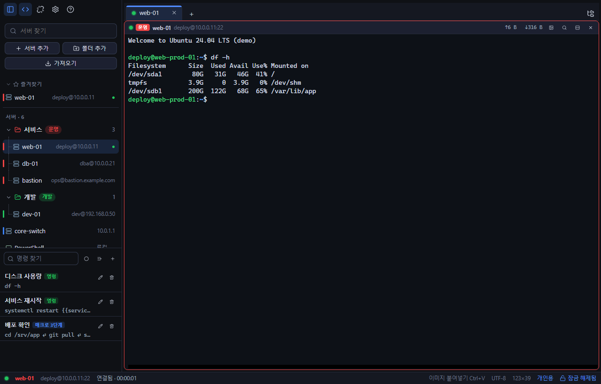 | 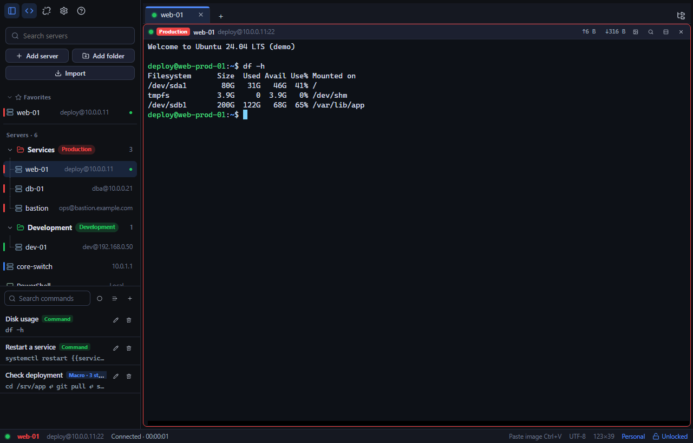 |
| servers | 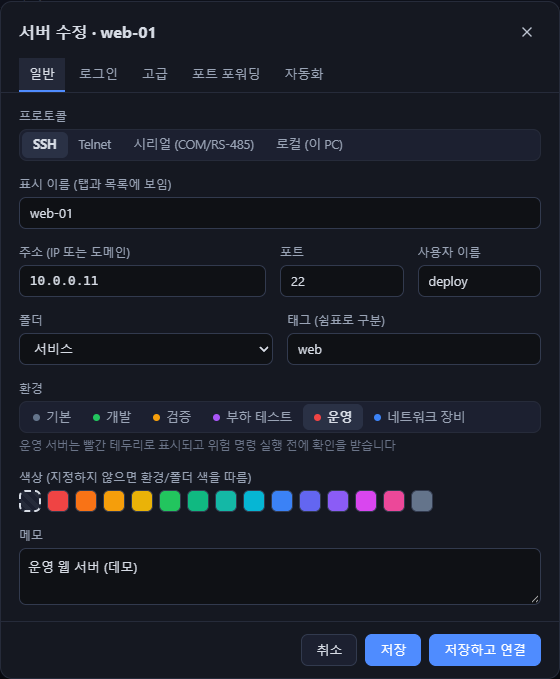 | 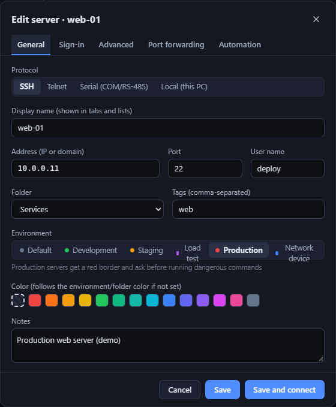 |
| connect | 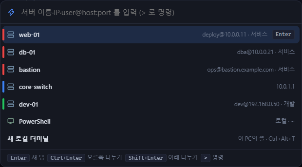 | 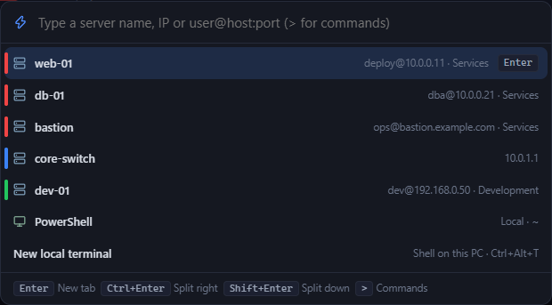 |
| vault | 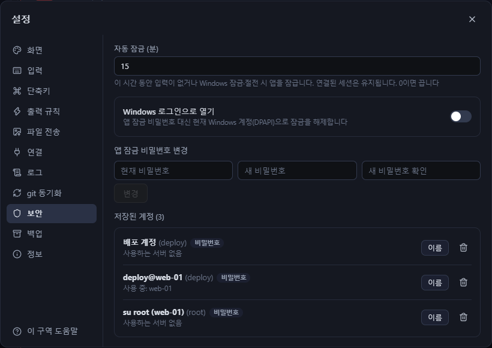 | 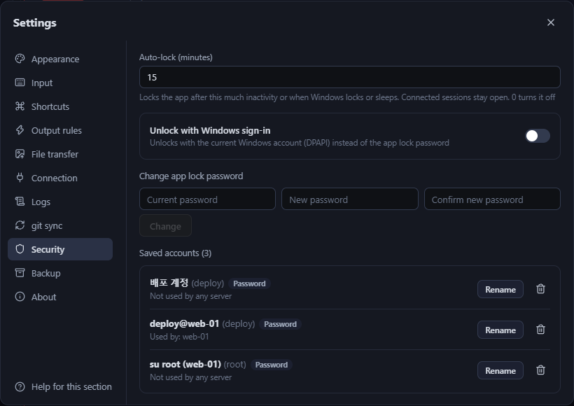 |
| proxy | 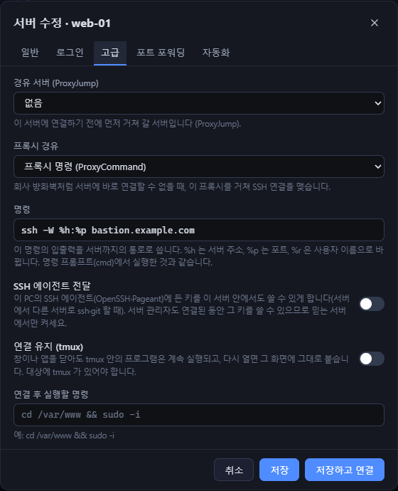 | 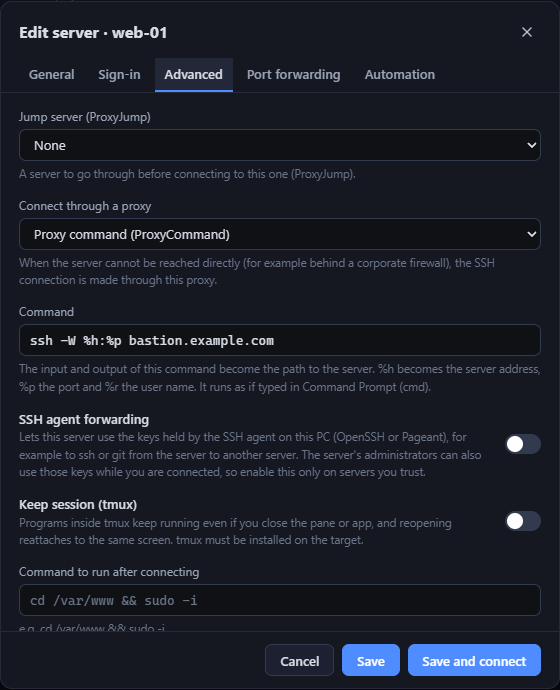 |
| forward | 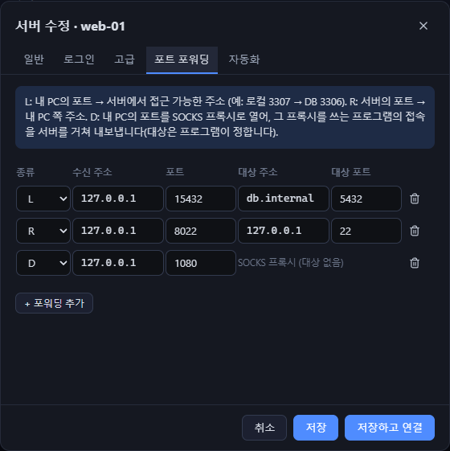 | 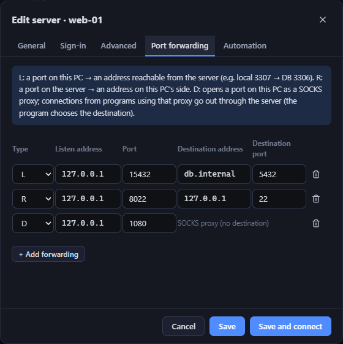 |
| macros | 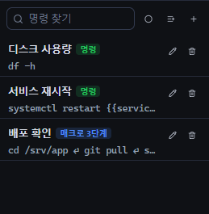 | 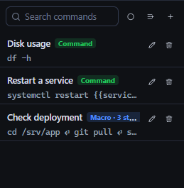 |
| login-script | 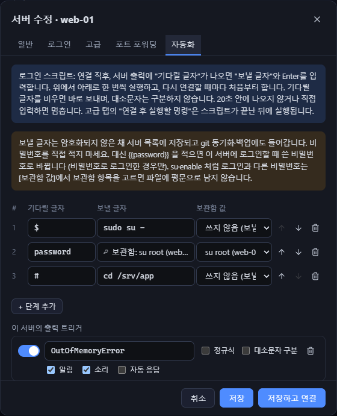 | 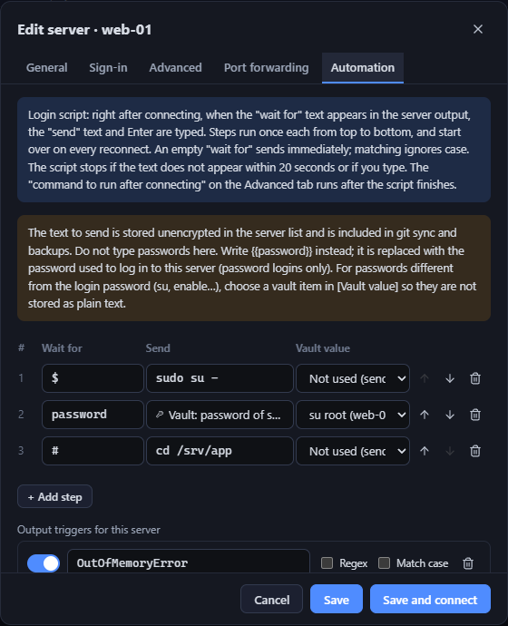 |
| triggers | 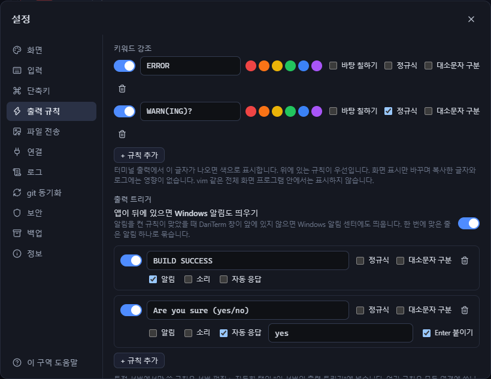 | 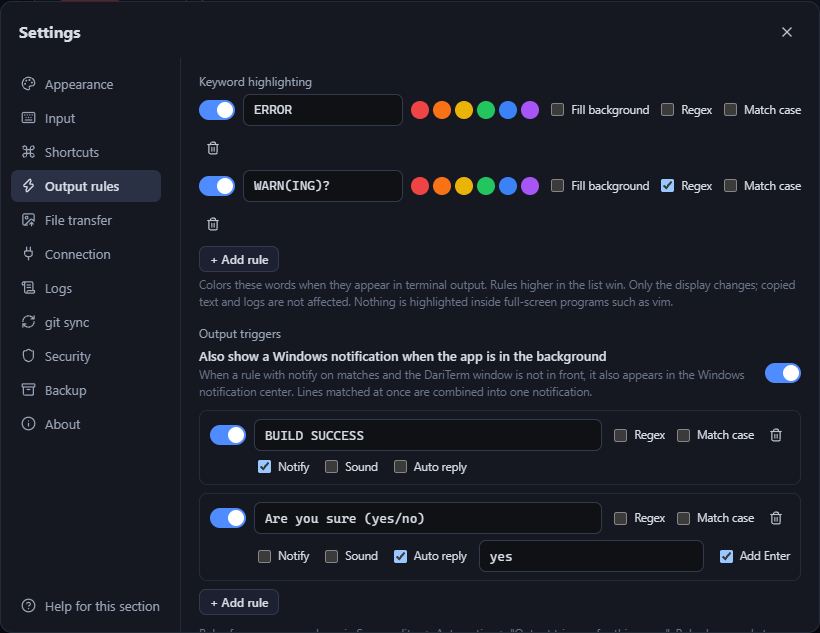 |
| log | 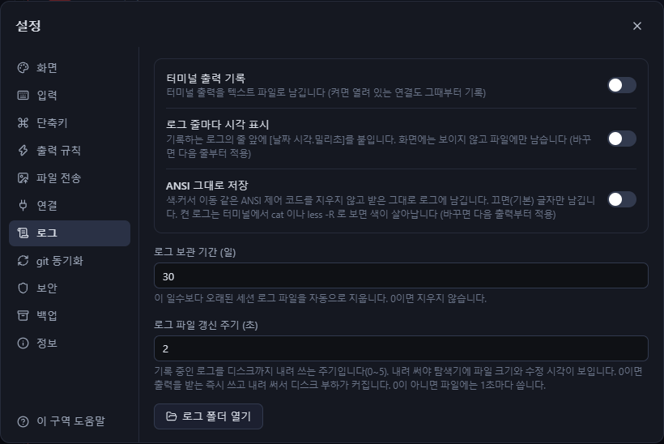 | 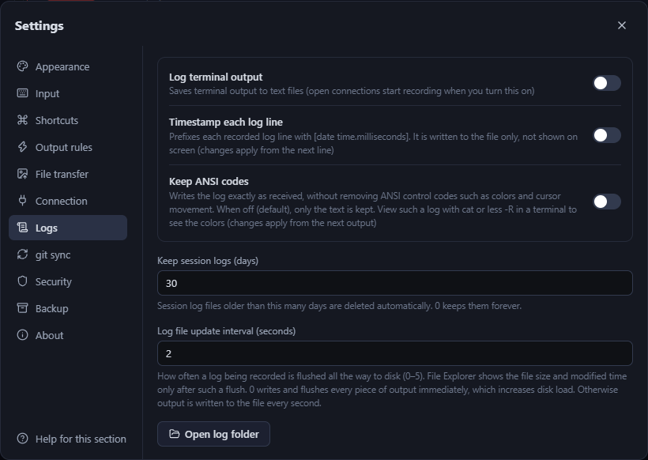 |
| shortcuts | 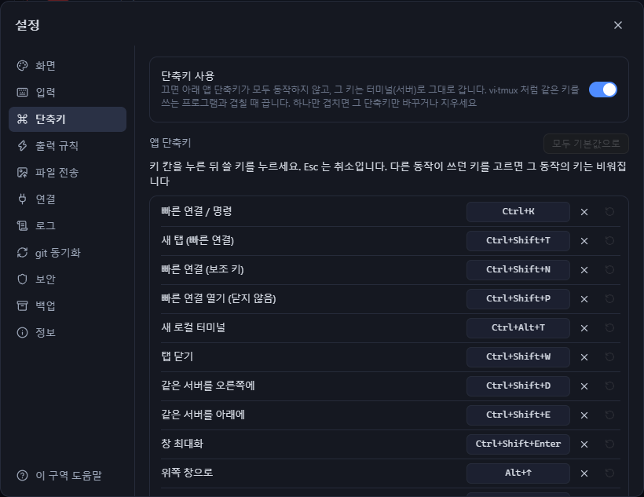 | 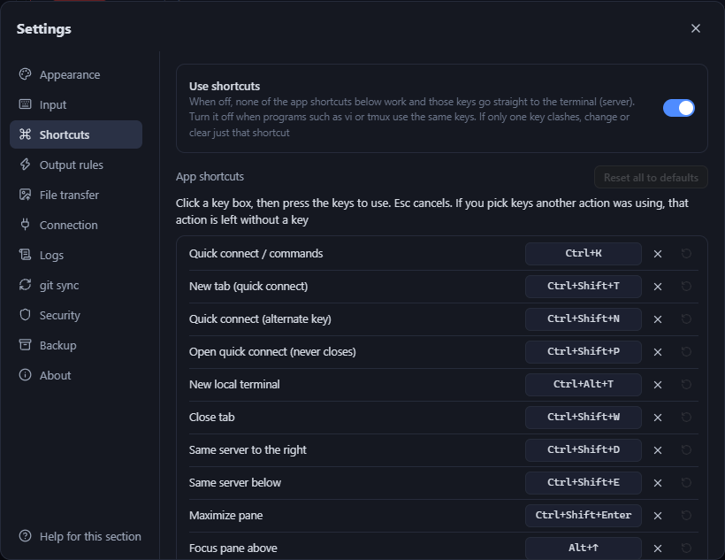 |
| settings | 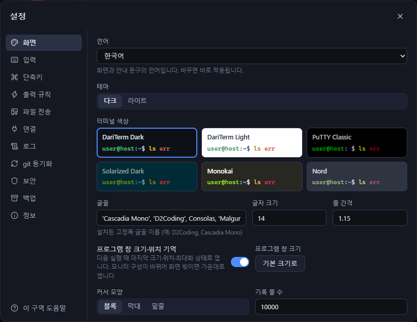 | 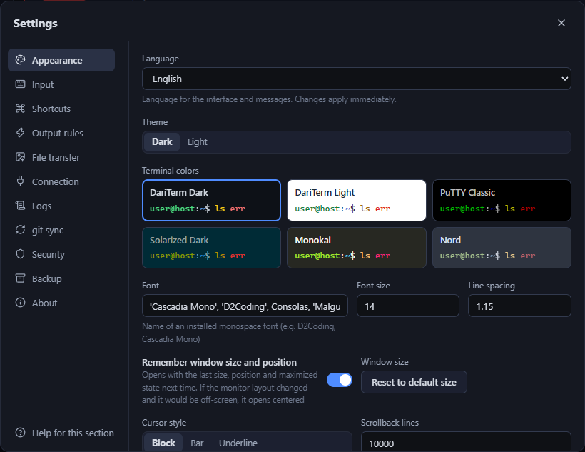 |

## 5. 자동 캡처 (D158)

### 5.1 처음 계획과 바꾼 까닭 (조사 기록)

처음 권장안은 "실제 앱(dariterm.exe)을 WebView2 디버그 포트를 열고 띄워 Playwright 가 붙는다"였다. 시험해 보니 막혔다.

| 시도 | 결과 |
|---|---|
| `WEBVIEW2_ADDITIONAL_BROWSER_ARGUMENTS=--remote-debugging-port=9333` + `WEBVIEW2_USER_DATA_FOLDER` 로 앱 실행 | 포트가 열리지 않음. 사용자 데이터 폴더도 쓰이지 않음 |
| 원인 확인 | Wails v2.17.1 `internal/frontend/desktop/windows/frontend.go` `setupChromium` 이 늘 `--disable-features=msSmartScreenProtection` 을 브라우저 인자로 주고, 사용자 데이터 경로도 직접 정한다(`options.Windows.WebviewUserDataPath`, 비면 `%APPDATA%\<exe 이름>`). 브라우저 인자를 더할 옵션은 없다 |
| main.go 에 캡처 모드 추가(`EnableFraudulentWebsiteDetection: true` 로 Wails 인자를 없애고 `WebviewUserDataPath` 를 데모 폴더로) | 데모 폴더는 쓰였지만 포트는 여전히 닫힘 — Wails 의 순수 Go WebView2 로더(go-webview2 v1.0.23)는 환경 변수를 읽지 않는다 |
| `-tags native_webview2loader`(옛 DLL 로더)로 따로 빌드 | 여전히 닫힘. WebView2 브라우저 프로세스의 명령 줄에 `--remote-debugging-port` 가 없었다 |

그래서 **main.go 의 캡처 모드는 되돌렸고**(앱 Go 코드는 이번에 바뀌지 않았다), 아래 방식으로 바꿨다. 화면(React 코드·CSS)은 앱과 같은 것이고, 데이터만 가짜 백엔드(`src/ipc/fakeBackend.ts` — 원래 "개발 서버·설명서 그림용"으로 있던 것)에서 온다.

### 5.2 방식

1. `vite` 의 `createServer({ root: frontend, configFile: vite.config.ts, server: { host: '127.0.0.1', port: 5299, strictPort: false } })` 로 개발 서버를 띄운다. 페이지에 Wails 전역(`window.go`)이 없으므로 `initBackend` 가 가짜 백엔드를 고른다(-17 이전부터 있던 동작).
2. `chromium.launch({ channel: 'msedge', headless: true })` — 이 PC 의 Microsoft Edge. Playwright 가 만드는 빈 임시 프로필.
3. 언어마다 새 컨텍스트(viewport 1280×820, deviceScaleFactor 1, colorScheme = 테마)를 만들고 `addInitScript` 로 **페이지를 열기 전에** `localStorage['dariterm.helpCapture'] = '1'`.
4. `main.tsx` 가 시작할 때 `installHelpCapture()` → 표시가 있으면 `window.__dtHelpCapture = { ui, app, saveSettings, invoke, openHost }`.
5. 손잡이로: `vault.setup`(가짜), `cred.save` 두 개(가짜 비밀) → `patchStore`(폴더 2, 서버 6, 명령 2, 매크로 1, `appUi.importSuggested`) → `saveSettings`(언어, 개인용, 회사 PC 안내 끝, 테마, 강조 규칙 2, 트리거 2, Windows 알림) → `refreshVault`.
6. 화면마다: 열린 것을 모두 닫고(`resetUi`) → 연다 → (서버 편집이면) `[role=tab][data-tab=…]` 누르기 → (있으면) 값이 같은 입력 칸을 가운데로 스크롤 → (있으면) 터미널에 글자 치고 Enter → 글꼴 준비 + 두 번 그리기 + 300ms → 찍기.
7. 저장: `locales/help/img/<언어>/<id>.png`(덮어씀).

### 5.3 찍는 화면

| id | 찍는 것 | 여는 방법 |
|---|---|---|
| screen | 창 전체 | 명령 모음 열기 + web-01 을 새 탭으로(`openHost`) + `df -h` Enter(가짜 백엔드의 흉내 출력) |
| servers | 서버 편집 대화상자 | `openEditor({ kind: 'host', hostId: web })`, 탭 `basic` |
| proxy | 〃 | 탭 `adv`, `ssh -W %h:%p bastion.example.com` 칸을 가운데로 |
| forward | 〃 | 탭 `fwd`(L·R·D 세 개) |
| login-script | 〃 | 탭 `auto`(스크립트 3단계 — 2단계는 보관함 값, 이 서버의 트리거 1개) |
| connect | `.quick` | `openQuick()` |
| macros | `.snippet-dock` | `setSnippetsOpen(true)` |
| vault | 설정 대화상자 | `openSettings('security')` |
| triggers | 〃 | `openSettings('rules')` |
| shortcuts | 〃 | `openSettings('shortcuts')` |
| settings | 〃 | `openSettings('appearance')` |
| log | 〃 | `openSettings('log')` |

데모 데이터: 서버 `web-01`(10.0.0.11, 운영, 즐겨찾기, 프록시 명령, 포워딩 3, 로그인 스크립트 3, 트리거 1), `db-01`(10.0.0.21, 경유 bastion), `bastion`(bastion.example.com, 에이전트), `dev-01`(192.168.0.50, 개발), `core-switch`(텔넷 10.0.1.1, 장비), `PowerShell`(로컬). 폴더 서비스/Services(운영), 개발/Development(개발). 계정 `deploy@web-01`, `su root (web-01)` — 비밀번호 `not-a-real-password`. 모두 가짜 백엔드의 메모리에만 있다.

### 5.4 손잡이 — `frontend/src/lib/helpCapture.ts` (새 파일)

````ts
// 도움말 그림 자동 캡처(frontend/scripts/help-capture.mjs, D158)가 화면을 여는 손잡이.
// 화면 저장소에 dariterm.helpCapture=1 이 있을 때만 window.__dtHelpCapture 를 만든다. 캡처 스크립트는
// vite 개발 서버 + 가짜 백엔드(ipc/fakeBackend.ts)를 Playwright 의 빈 임시 Edge 프로필로 열 때만 이 값을 넣으므로
// 앱(WebView2)에는 생기지 않는다. 손잡이는 이미 페이지 안의 상태(zustand 저장소)를 가리킬 뿐이라 새 권한을 주지 않는다.
import { getBackend } from '../ipc/backend';
import { useApp } from '../state/app';
import { useUi } from '../state/ui';
import { saveSettings } from '../state/settings';
import { openHost } from '../state/actions';

export const HELP_CAPTURE_KEY = 'dariterm.helpCapture';

export interface HelpCaptureHandle {
  ui: typeof useUi;
  app: typeof useApp;
  saveSettings: typeof saveSettings;
  /** 백엔드 채널 부르기(캡처 때는 가짜 백엔드). */
  invoke: (channel: string, args?: unknown[]) => Promise<unknown>;
  /** 서버를 새 탭으로 연다(가짜 백엔드는 흉내 터미널). */
  openHost: (hostId: string) => Promise<void>;
}

/** 캡처 모드면 손잡이를 window 에 단다. 저장소를 읽을 수 없으면 아무것도 하지 않는다. 달았으면 true. */
export function installHelpCapture(target: Record<string, unknown> = globalThis as unknown as Record<string, unknown>): boolean {
  let on = false;
  try {
    on = globalThis.localStorage?.getItem(HELP_CAPTURE_KEY) === '1';
  } catch {
    on = false;
  }
  if (!on) return false;
  const handle: HelpCaptureHandle = {
    ui: useUi,
    app: useApp,
    saveSettings,
    invoke: (channel, args = []) => getBackend().invoke(channel, args),
    openHost: (hostId) => openHost(hostId),
  };
  target.__dtHelpCapture = handle;
  return true;
}
````

`frontend/src/main.tsx`:

````diff
 import { App } from './App';
+import { installHelpCapture } from './lib/helpCapture';
+
+// 도움말 그림 자동 캡처 때만(데모 프로필의 화면 저장소 표시) 화면을 여는 손잡이를 단다. D158.
+installHelpCapture();
 
 createRoot(document.getElementById('root')!).render(
````

### 5.5 서버 편집 탭에 `data-tab` — `frontend/src/screens/HostEditor.tsx`

스크립트가 언어와 상관없이 탭을 찾게 한다(화면 변화 없음).

````diff
           <button
             key={t.id}
             role="tab"
+            data-tab={t.id}
             aria-selected={curTab === t.id}
````

### 5.6 `frontend/package.json`

````diff
     "typecheck": "tsc --noEmit",
-    "test": "node run-vitest.mjs run"
+    "test": "node run-vitest.mjs run",
+    "help:capture": "node scripts/help-capture.mjs"
   },
 ...
   "devDependencies": {
 ...
     "jsdom": "31.0.1",
+    "playwright-core": "1.65.0",
     "typescript": "7.0.2",
````

설치 명령(frontend 폴더): `npm install -D --save-exact playwright-core@1.65.0` — package-lock.json 도 바뀐다. 브라우저 내려받기는 없다(`playwright-core` 는 브라우저를 받지 않는다).

### 5.7 스크립트 — `frontend/scripts/help-capture.mjs` (새 파일)

전체 코드는 부록 D. 쓰는 법:

````powershell
cd frontend
npm run help:capture                                   # ko·en, 12화면 = 24장
npm run help:capture -- --langs ko --only proxy,forward
npm run help:capture -- --theme light --headed         # 밝은 테마, 창을 보이며
# 다시 찍은 그림을 계획서 폴더(공유되는 곳)에도 넣기 — 그림을 고쳤으면 반드시
npm run help:capture -- --copy-to ../docs/import-plans/2026-11-27-18-help-sort-faq-images/img
````

- 찍은 그림은 늘 `locales/help/img/<언어>/` 에 쓴다(앱이 읽는 곳). `--copy-to <폴더>` 를 주면 같은 그림을 `<폴더>/<언어>/<id>.png` 로도 복사한다.

실행 결과(2026-11-27): 24장, 합계 1,079,287 바이트. exe 17,715,200 → 18,797,568 바이트(+1.08MB).

## 6. 로그인 스크립트 표 열 너비 (D157 작업 중 발견)

**원인**: `frontend/src/screens/LoginScriptTable.tsx` 의 표가 자동 배치(`table-layout: auto`)라, 보관함 값을 고른 단계의 "보관함: … 의 비밀번호" 글(`white-space: nowrap`)이 "보낼 글자" 열을 넓히고 너비를 정하지 않은 "기다릴 글자" 열이 한 글자 폭으로 줄었다(머리글이 세로로 한 글자씩 보였다). -10(보관함 값 열) 때 생긴 문제다. 자동 캡처 그림에서 보였다.

**수정**:

````diff
   const nameOf = (id: string) => secrets.find((s) => s.id === id)?.name;
+  // 표는 열 너비를 고정한다(D157 작업 중 발견): 자동 배치면 보관함 값의 긴 안내 글이 "보낼 글자" 열을 넓혀
+  // "기다릴 글자" 열이 글자 하나 폭으로 줄어들었다.
   return (
 ...
-        <table className="fwd-table" style={{ width: '100%', borderCollapse: 'separate', borderSpacing: '0 6px' }}>
+        <table className="fwd-table" style={{ width: '100%', tableLayout: 'fixed', borderCollapse: 'separate', borderSpacing: '0 6px' }}>
           <thead>
             <tr className="faint small" style={{ textAlign: 'left' }}>
               <th style={{ width: 26 }}>#</th>
-              <th>{t('login.expect')}</th>
+              <th style={{ width: '22%' }}>{t('login.expect')}</th>
               <th>{t('login.send')}</th>
-              <th style={{ width: 150 }}>{t('login.secret')}</th>
-              <th style={{ width: 96 }} />
+              <th style={{ width: 128 }}>{t('login.secret')}</th>
+              <th style={{ width: 88 }} />
````

JSX 주석을 `{rows.length > 0 && ( … )}` 괄호 바로 안에 두면 파싱 오류가 난다(시험해 봄) — 그래서 `return` 앞 JS 주석으로 두었다.

## 7. 문구 (10개 언어) — `locales/<언어>.json`

`"help.thisSection"` 줄 바로 뒤에 다섯 키를 넣는다.

| 키 | ko | en | ja | zh | tw | de | fr | es | pt | ru |
|---|---|---|---|---|---|---|---|---|---|---|
| `help.sort` | 목록 순서 | List order | 一覧の順序 | 列表顺序 | 清單順序 | Reihenfolge | Ordre de la liste | Orden de la lista | Ordem da lista | Порядок списка |
| `help.sortFeature` | 기능 순서 | By feature | 機能順 | 按功能 | 依功能 | Nach Funktion | Par fonction | Por función | Por função | По функциям |
| `help.sortName` | 가나다순 | A–Z | 名前順 | 按名称 | 依名稱 | A–Z | A–Z | A–Z | A–Z | А–Я |
| `help.imgZoom` | 눌러서 크게 보기 | Click to enlarge | クリックで拡大 | 点击放大 | 按一下放大 | Zum Vergrößern klicken | Cliquer pour agrandir | Haz clic para ampliar | Clique para ampliar | Нажмите, чтобы увеличить |
| `help.imgShrink` | 눌러서 줄이기 | Click to shrink | クリックで縮小 | 点击缩小 | 按一下縮小 | Zum Verkleinern klicken | Cliquer pour réduire | Haz clic para reducir | Clique para reduzir | Нажмите, чтобы уменьшить |

## 8. 스타일 — `frontend/src/styles/settings.css`

`.help-wrap mark { … }` 줄 바로 뒤에 넣는다.

````css
/* 목록 정렬(기능 순서 / 이름순), D156 */
.help-sort { display: flex; gap: 2px; padding: 2px; border: 1px solid var(--border); border-radius: 6px; }
.help-sort-btn { flex: 1; height: 24px; border: 0; border-radius: 4px; background: none; color: var(--fg-2); font: inherit; font-size: 12px; cursor: pointer; }
.help-sort-btn:hover { color: var(--fg); background: var(--hover); }
.help-sort-btn.on { background: var(--active); color: var(--fg); font-weight: 600; }
/* 자주 묻는 질문: 질문마다 카드 하나, D157 */
.help-qa { margin: 0 0 10px; padding: 10px 12px; border: 1px solid var(--border); border-radius: 8px; background: var(--hover); }
.help-q { display: flex; gap: 8px; align-items: baseline; font-weight: 600; }
.help-a { display: flex; gap: 8px; align-items: baseline; margin-top: 6px; color: var(--fg-2); }
.help-q-mark { flex: none; width: 18px; height: 18px; border-radius: 4px; display: inline-flex; align-items: center; justify-content: center; font-size: 11px; font-weight: 700; background: var(--accent); color: #fff; }
.help-q-mark.a { background: var(--border); color: var(--fg); }
.help-qa code { background: var(--active); } /* 카드 바탕(--hover)과 같은 색이면 코드가 안 보인다 */
/* 그림, D158: 보통은 본문 폭·높이 360px 안에, 누르면 실제 크기 */
.help-fig { margin: 0 0 12px; }
.help-fig-btn { display: block; padding: 0; border: 1px solid var(--border); border-radius: 6px; background: none; cursor: zoom-in; max-width: 100%; overflow: hidden; }
.help-fig-btn img { display: block; max-width: 100%; max-height: 360px; object-fit: contain; }
.help-fig.zoom .help-fig-btn { cursor: zoom-out; overflow: auto; }
.help-fig.zoom .help-fig-btn img { max-width: none; max-height: none; }
.help-fig figcaption { margin-top: 4px; }
````

## 9. 테스트

| 파일 | 테스트 | 확인 |
|---|---|---|
| `lib/help.followup.test.ts`(새) | 기능 순서는 그대로·원래 배열 안 바뀜 | id 순서 같음, 다른 배열 |
| 〃 | 한국어 이름순은 가나다 | `Intl.Collator('ko')` 순, 첫 항목 "개인용·업무용과 업데이트" |
| 〃 | 영어 이름순은 ABC | 이웃끼리 비교, 첫 항목이 a 로 시작 |
| 〃 | `tw`·이상한 코드도 오류 없음 | 길이 같음 |
| 〃 | 고른 순서 기억 | 없으면 feature, name 저장·읽기, 모르는 값이면 feature |
| 〃 | FAQ 카드: ko·en 9개 이상·같은 수, 질문·답 비지 않음 | |
| 〃 | 예전 `**질문**` 문단이 없다 | |
| 〃 | `Q:` 파싱(여러 줄 답, 다음 Q·빈 줄에서 끝) | 블록 배열 그대로 비교 |
| 〃 | 질문·답이 검색된다 | `화면 보호기`·`screen saver` → faq |
| 〃 | 그림 줄 파싱, 설명이 검색 글에 | |
| 〃 | 경로·대문자·gif·뒤에 글이 붙은 줄은 그림 아님 | 5가지 → 문단 |
| 〃 | 그림 주소 대체 순서(언어 → en → ko → null) | 가짜 표로 |
| 〃 | 본문이 가리키는 그림 파일이 ko·en 모두 있다 | 12개 이상, 주소에 `/ko/`·`/en/` |
| 〃 | ko·en 의 그림이 같은 항목·같은 파일 | |
| `lib/helpCapture.test.ts`(새) | 표시가 없으면 손잡이 없음 / `'1'` 일 때만 생기고 다섯 가지가 있다 | `'true'` 는 아님 |
| `screens/HelpDialog.test.tsx` | 기본 기능 순서 → [가나다순] → 다시 열어도 가나다순 → [기능 순서] | 28개, 첫 항목 |
| 〃 | 검색 중에는 정렬 단추가 없고 결과가 맞은 정도 순 | |
| 〃 | 영어에서 [A–Z] | |
| 〃 | FAQ 카드 9개 이상, 첫 카드의 Q·A 글 | |
| 〃 | 그림: `ko/proxy.png`, 설명, 누르면 `zoom`·다시 누르면 해제 | |

`HelpDialog.test.tsx` 의 `beforeEach` 에 `localStorage.removeItem('dariterm.helpSort')` 를 더했다(테스트끼리 순서 기억이 섞이지 않게). 새·바뀐 테스트 코드 전체는 부록 E.

## 10. 다른 곳에 적용하는 순서

1. -17 이 적용되어 있는지 확인(`frontend/src/lib/help.ts`, `locales/help/{ko,en}.md`).
2. §7 문구 50개(5키 × 10개 언어).
3. `help.ts` 를 부록 A 로, `HelpDialog.tsx` 를 부록 B 로 바꾼다.
4. §8 CSS, §6 LoginScriptTable, §5.5 HostEditor `data-tab`.
5. `helpCapture.ts`(§5.4) + `main.tsx`.
6. 본문 `ko.md`·`en.md`: §4.4 의 diff 대로(머리 주석 2줄, 그림 줄 12개, §3.3 FAQ 로 교체).
7. `npm install -D --save-exact playwright-core@1.65.0`, `package.json` 의 `help:capture`, `scripts/help-capture.mjs`(부록 D).
8. **그림: §4.5 의 명령으로 `locales/help/img/` 를 만들고 이 계획서 폴더(`2026-11-27-18-help-sort-faq-images/img/`)의 `ko`·`en` 을 폴더째 옮긴다(복사).** 화면이 이곳과 다르면 대신 `npm run help:capture` 로 새로 찍는다.
9. 테스트(부록 E) → `npx tsc --noEmit`, `node run-vitest.mjs run`(PowerShell 에서), `wails build`.
10. 명세 spec/ui/help.md, decisions D156~D158, CHANGELOG.

## 11. 검증 결과 (2026-11-27)

- `npx tsc --noEmit` 통과.
- vitest **66개 파일·486개 통과**(이번 작업 전 64개·465개). jsdom 의 "HTMLCanvasElement getContext" 안내는 전부터 나오던 것(xterm)이다.
- `go vet .` 통과(main.go 는 되돌려 바뀐 것 없음).
- `wails build` 성공(`build/bin/dariterm.exe`, 18,797,568 바이트).
- 캡처 24장을 눈으로 확인했다. 그때 §6 의 표 문제를 찾아 고치고 다시 찍었다. macros 는 처음에 `.sidebar`(서버 목록)를 찍어 명령 모음이 빠져서 `.snippet-dock` 으로 바꿨다.
- 도움말 창을 Edge 에서 어두운·밝은 테마로 찍어 확인: 정렬 단추, 가나다순 목록, 그림(줄인 크기), FAQ 카드. 밝은 테마에서 카드 안의 `코드` 바탕이 카드 바탕과 같아 안 보여 `.help-qa code { background: var(--active); }` 를 더했다.

## 12. 남은 일

- 8개 언어 본문 번역(-17 의 남은 일 그대로). 그 언어 본문을 만들면 그림은 en 것을 쓰고, 그 언어로 찍으려면 `--langs ja` 처럼(스크립트의 `TEXT` 에 그 언어 데모 이름을 더하면 폴더·명령 이름도 그 언어로).
- 밝은 테마 그림: 지금은 어두운 테마 그림만. 테마별로 보이려면 `img/<언어>/light/` 같은 폴더와 `helpImage` 에 테마 인자가 필요.
- 화면이 바뀌면 `npm run help:capture` 를 다시 돌린다(CLAUDE.md 작업 순서의 "도움말도 함께 고친다"에 포함).

## H. 수동 검증

| # | 하는 일 | 기대 | 결과 |
|---|---|---|---|
| 1 | 앱에서 도움말 → [가나다순] | 첫 항목 "개인용·업무용과 업데이트", 단추 강조 | |
| 2 | 도움말을 닫고 앱을 다시 실행 → 도움말 | 가나다순 그대로 | |
| 3 | 검색 칸에 글자 | 정렬 단추가 사라지고 결과 개수 | |
| 4 | 언어 English → 도움말 → [A–Z] | ABC 순 | |
| 5 | "자주 묻는 질문" | 질문 9개가 카드, Q·A 표시 | |
| 6 | "프록시와 프록시 명령"의 그림 누르기 / 다시 누르기 | 실제 크기 / 다시 줄임 | |
| 7 | 인터넷을 끊고 그림이 있는 항목 | 그림이 보인다(exe 안) | |
| 8 | 밝은 테마에서 FAQ·그림 | 읽기 좋다(그림은 어두운 테마 화면) | |
| 9 | 서버 편집 > 자동화, 보관함 값 단계가 있는 스크립트 | "기다릴 글자" 열이 넓게 보인다 | |

## 체크리스트

- [x] 정렬 · [x] FAQ 카드 · [x] 그림 표시 · [x] 자동 캡처 스크립트 · [x] 그림 24장(계획서 폴더에 첨부, §4.5) · [x] 문구 10개 언어 · [x] 로그인 스크립트 표 · [x] 명세 · [x] 테스트 · [x] 빌드 · [ ] §H

---

## 부록 A. `frontend/src/lib/help.ts` (바뀐 뒤 전체)

````ts
// 도움말 본문 읽기·검색(D155). 본문은 locales/help/<언어>.md 에 두고(코드에 문구를 두지 않는다, D75),
// 그 언어 파일이 없으면 영어, 그것도 없으면 한국어를 쓴다. 근거: spec/ui/help.md.
//
// 형식(작은 마크다운): "## 제목 {#id}" 가 항목 하나. ### 소제목, 문단, "- "·"1. " 목록(두 칸 이상 들여 쓴 줄은 바로 위 항목의 하위),
// 표(| a | b |, 둘째 줄은 구분선), "> " 안내, ``` 코드 블록, 글자 안의 **굵게**·`코드`. 맨 앞의 <!-- --> 주석은 버린다.
// "Q: 질문" 줄과 그 아래 줄들(빈 줄까지)은 질문·답 한 묶음(자주 묻는 질문, D157).
// "" 한 줄은 그림(locales/help/img/<언어>/파일, D158). 그림 파일이 없으면 그리지 않는다.

export type HelpBlock =
  | { kind: 'h'; text: string }
  | { kind: 'p'; text: string }
  | { kind: 'ul' | 'ol'; items: { text: string; sub: string[] }[] }
  | { kind: 'table'; head: string[]; rows: string[][] }
  | { kind: 'note'; text: string }
  | { kind: 'code'; text: string }
  | { kind: 'qa'; q: string; a: string }
  | { kind: 'img'; src: string; alt: string };

export interface HelpTopic {
  id: string;
  title: string;
  blocks: HelpBlock[];
  /** 검색용: 제목과 본문의 글자(꾸밈 기호를 뺀 것, 소문자). */
  haystack: string;
}

const TOPIC_RE = /^##\s+(.+?)\s*\{#([a-z0-9-]+)\}\s*$/;
/** 그림 줄. 파일 이름은 소문자·숫자·하이픈과 확장자만(경로를 벗어나지 못하게). */
const IMG_RE = /^!\[([^\]]*)\]\(([a-z0-9-]+\.(?:png|webp|jpg))\)$/;
const QA_RE = /^Q:\s+(.+)$/;

/** 꾸밈 기호(** ` )를 뺀 글자. */
export function plainText(s: string): string {
  return s.replace(/\*\*([^*]+)\*\*/g, '$1').replace(/`([^`]+)`/g, '$1');
}

function splitRow(line: string): string[] {
  return line.trim().replace(/^\|/, '').replace(/\|$/, '').split('|').map((c) => c.trim());
}

function blockText(b: HelpBlock): string {
  switch (b.kind) {
    case 'ul':
    case 'ol':
      return b.items.map((i) => [i.text, ...i.sub].join(' ')).join(' ');
    case 'table':
      return [...b.head, ...b.rows.flat()].join(' ');
    case 'qa':
      return `${b.q} ${b.a}`;
    case 'img':
      return b.alt;
    default:
      return b.text;
  }
}

/** 도움말 파일을 항목 목록으로 읽는다. 제목 줄({#id})이 없는 앞부분은 버린다. */
export function parseHelp(src: string): HelpTopic[] {
  const lines = src.replace(/<!--[\s\S]*?-->/g, '').replace(/\r\n/g, '\n').split('\n');
  const topics: HelpTopic[] = [];
  let cur: HelpTopic | null = null;
  let i = 0;
  const push = (b: HelpBlock) => cur?.blocks.push(b);
  while (i < lines.length) {
    const line = lines[i];
    const trimmed = line.trim();
    const m = TOPIC_RE.exec(trimmed);
    if (m) {
      cur = { id: m[2], title: m[1], blocks: [], haystack: '' };
      topics.push(cur);
      i++;
      continue;
    }
    if (!cur || trimmed === '') {
      i++;
      continue;
    }
    if (trimmed.startsWith('```')) {
      const body: string[] = [];
      i++;
      while (i < lines.length && !lines[i].trim().startsWith('```')) body.push(lines[i++]);
      i++; // 닫는 ```
      push({ kind: 'code', text: body.join('\n') });
      continue;
    }
    if (trimmed.startsWith('### ')) {
      push({ kind: 'h', text: trimmed.slice(4) });
      i++;
      continue;
    }
    if (trimmed.startsWith('|')) {
      const rows: string[][] = [];
      while (i < lines.length && lines[i].trim().startsWith('|')) {
        const cells = splitRow(lines[i]);
        if (!cells.every((c) => /^:?-{2,}:?$/.test(c))) rows.push(cells);
        i++;
      }
      push({ kind: 'table', head: rows[0] ?? [], rows: rows.slice(1) });
      continue;
    }
    const img = IMG_RE.exec(trimmed);
    if (img) {
      push({ kind: 'img', alt: img[1], src: img[2] });
      i++;
      continue;
    }
    const qa = QA_RE.exec(trimmed);
    if (qa) {
      // 답: 다음 줄부터 빈 줄 전까지(다음 "Q:" 나 항목 제목이 오면 거기서 끝).
      const body: string[] = [];
      i++;
      while (i < lines.length) {
        const t = lines[i].trim();
        if (t === '' || QA_RE.test(t) || TOPIC_RE.test(t)) break;
        body.push(t);
        i++;
      }
      push({ kind: 'qa', q: qa[1], a: body.join(' ') });
      continue;
    }
    if (trimmed.startsWith('> ')) {
      const body: string[] = [];
      while (i < lines.length && lines[i].trim().startsWith('>')) body.push(lines[i++].trim().replace(/^>\s?/, ''));
      push({ kind: 'note', text: body.join(' ') });
      continue;
    }
    const listOf = (s: string): 'ul' | 'ol' | null => (/^- /.test(s) ? 'ul' : /^\d+\. /.test(s) ? 'ol' : null);
    const kind = !/^\s/.test(line) ? listOf(trimmed) : null;
    if (kind) {
      const items: { text: string; sub: string[] }[] = [];
      while (i < lines.length) {
        const l = lines[i];
        const t = l.trim();
        if (t === '') break;
        if (/^\s{2,}/.test(l) && items.length > 0) {
          // 들여 쓴 줄: 바로 위 항목의 하위 목록(또는 이어지는 글)
          items[items.length - 1].sub.push(t.replace(/^(- |\d+\. )/, ''));
          i++;
          continue;
        }
        if (listOf(t) !== kind) break;
        items.push({ text: t.replace(/^(- |\d+\. )/, ''), sub: [] });
        i++;
      }
      push({ kind, items });
      continue;
    }
    // 문단: 빈 줄이나 다른 블록이 나올 때까지 잇는다.
    const body: string[] = [];
    while (i < lines.length) {
      const t = lines[i].trim();
      if (t === '' || TOPIC_RE.test(t) || IMG_RE.test(t) || QA_RE.test(t) || t.startsWith('```') || t.startsWith('### ') || t.startsWith('|') || t.startsWith('> ') || (!/^\s/.test(lines[i]) && listOf(t))) break;
      body.push(t);
      i++;
    }
    push({ kind: 'p', text: body.join(' ') });
  }
  for (const t of topics) t.haystack = plainText([t.title, ...t.blocks.map(blockText)].join(' ')).toLowerCase();
  return topics;
}

/** 검색어를 낱말로 나눈다(공백 기준, 소문자, 빈 것 제외). */
export function searchTerms(query: string): string[] {
  return query.toLowerCase().split(/\s+/).filter(Boolean);
}

export interface HelpHit {
  topic: HelpTopic;
  /** 본문에 나온 횟수(낱말마다 센 합). 제목에 나오면 크게 더한다. */
  score: number;
  /** 첫 번째로 맞은 자리 둘레의 글(목록에 보일 미리 보기). */
  snippet: string;
}

/**
 * 모든 낱말이 들어 있는 항목만, 많이 맞은 순서로 돌려준다(같으면 원래 순서).
 * 제목에 들어 있으면 본문보다 앞에 온다. 검색어가 비면 빈 배열.
 */
export function searchHelp(topics: readonly HelpTopic[], query: string): HelpHit[] {
  const terms = searchTerms(query);
  if (terms.length === 0) return [];
  const hits: (HelpHit & { order: number })[] = [];
  topics.forEach((topic, order) => {
    if (!terms.every((w) => topic.haystack.includes(w))) return;
    const title = topic.title.toLowerCase();
    let score = 0;
    for (const w of terms) {
      if (title.includes(w)) score += 100;
      score += topic.haystack.split(w).length - 1;
    }
    const at = topic.haystack.indexOf(terms[0], title.length);
    const from = Math.max(0, (at < 0 ? 0 : at) - 30);
    const raw = plainText([topic.title, ...topic.blocks.map(blockText)].join(' '));
    const snippet = (from > 0 ? '…' : '') + raw.slice(from, from + 90).trim() + (raw.length > from + 90 ? '…' : '');
    hits.push({ topic, score, snippet, order });
  });
  hits.sort((a, b) => b.score - a.score || a.order - b.order);
  return hits.map(({ topic, score, snippet }) => ({ topic, score, snippet }));
}

/** 글을 검색 낱말 기준으로 조각낸다: [글, 맞은 곳인지]. 대소문자 무시. */
export function markParts(text: string, terms: readonly string[]): [string, boolean][] {
  if (terms.length === 0 || !text) return [[text, false]];
  const re = new RegExp(`(${terms.map((w) => w.replace(/[.*+?^${}()|[\]\\]/g, '\\$&')).join('|')})`, 'gi');
  return text.split(re).filter((s) => s !== '').map((s): [string, boolean] => [s, terms.includes(s.toLowerCase())]);
}

const FILES = import.meta.glob('../../../locales/help/*.md', { eager: true, query: '?raw', import: 'default' }) as Record<string, string>;
const SOURCES: Record<string, string> = Object.fromEntries(
  Object.entries(FILES).map(([path, src]) => [path.replace(/^.*\/([^/]+)\.md$/, '$1'), src]),
);
const cache = new Map<string, HelpTopic[]>();

// 그림: locales/help/img/<언어>/<파일>. 빌드 때 exe 에 함께 묶인다(URL 만 받고, 그리기는 ).
const IMAGE_FILES = import.meta.glob('../../../locales/help/img/*/*.{png,webp,jpg}', { eager: true, query: '?url', import: 'default' }) as Record<string, string>;
const IMAGES: Record<string, string> = Object.fromEntries(
  Object.entries(IMAGE_FILES).map(([path, url]) => [path.replace(/^.*\/img\/([^/]+)\/([^/]+)$/, '$1/$2'), url]),
);

/** 그림 주소: 그 언어 → 영어 → 한국어 순으로 찾는다. 없으면 null(그 그림은 그리지 않는다). */
export function helpImage(lang: string, file: string, images: Record<string, string> = IMAGES): string | null {
  return images[`${lang}/${file}`] ?? images[`en/${file}`] ?? images[`ko/${file}`] ?? null;
}

/** 목록 순서: 기능 순서(본문 파일의 순서) 또는 이름순(그 언어의 가나다·ABC). D156. */
export type HelpSort = 'feature' | 'name';

// 앱 언어 코드 → 정렬에 쓸 로캘. tw 는 BCP 47 코드가 아니라서 바꾼다.
const COLLATE_LOCALE: Record<string, string> = { tw: 'zh-TW' };

/** 항목을 고른 순서로. 이름순은 그 언어의 정렬 규칙(Intl.Collator), 숫자는 크기로. 원래 배열은 건드리지 않는다. */
export function sortTopics(topics: readonly HelpTopic[], sort: HelpSort, lang: string): HelpTopic[] {
  if (sort !== 'name') return [...topics];
  let coll: Intl.Collator;
  try {
    coll = new Intl.Collator(COLLATE_LOCALE[lang] ?? lang, { numeric: true, sensitivity: 'base' });
  } catch {
    coll = new Intl.Collator(undefined, { numeric: true, sensitivity: 'base' });
  }
  return [...topics].sort((a, b) => coll.compare(plainText(a.title), plainText(b.title)));
}

const SORT_KEY = 'dariterm.helpSort';

/** 마지막에 고른 순서(이 PC 의 화면 저장소). 읽을 수 없으면 기능 순서. */
export function loadHelpSort(): HelpSort {
  try {
    return globalThis.localStorage?.getItem(SORT_KEY) === 'name' ? 'name' : 'feature';
  } catch {
    return 'feature';
  }
}

export function saveHelpSort(sort: HelpSort): void {
  try {
    globalThis.localStorage?.setItem(SORT_KEY, sort);
  } catch {
    /* 저장 실패는 무시 — 다음에는 기능 순서 */
  }
}

/** 그 언어의 도움말(없으면 영어 → 한국어). fallback 은 다른 언어 본문을 대신 보였는지. */
export function helpFor(lang: string): { topics: HelpTopic[]; lang: string; fallback: boolean } {
  const pick = SOURCES[lang] ? lang : SOURCES.en ? 'en' : 'ko';
  let topics = cache.get(pick);
  if (!topics) {
    topics = parseHelp(SOURCES[pick] ?? '');
    cache.set(pick, topics);
  }
  return { topics, lang: pick, fallback: pick !== lang };
}

/** 설정 구역 → 도움말 항목 id (설정 화면의 [도움말] 단추가 연다). */
export const SETTINGS_HELP_TOPIC: Record<string, string> = {
  appearance: 'settings',
  input: 'terminal',
  shortcuts: 'shortcuts',
  rules: 'triggers',
  files: 'sftp',
  connection: 'connect',
  log: 'log',
  sync: 'sync',
  security: 'vault',
  backup: 'sync',
  about: 'license',
};
````

## 부록 B. `frontend/src/screens/HelpDialog.tsx` (바뀐 뒤 전체)

````tsx
// 도움말 창: 왼쪽은 검색 칸과 항목 목록, 오른쪽은 고른 항목의 설명. 검색어는 본문에서 강조한다.
// 근거: spec/ui/help.md (D155). 본문은 locales/help/<언어>.md(lib/help.ts).
import { Fragment, useMemo, useState, type ReactNode } from 'react';
import { CircleHelp, Search } from 'lucide-react';
import { Modal } from '../ui/Modal';
import {
  helpFor,
  helpImage,
  loadHelpSort,
  markParts,
  saveHelpSort,
  searchHelp,
  searchTerms,
  sortTopics,
  type HelpBlock,
  type HelpSort,
  type HelpTopic,
} from '../lib/help';
import { useUi } from '../state/ui';
import { t, useLang } from '../i18n';

/** 글자 안의 **굵게**·`코드` 를 그리고, 검색 낱말을 <mark> 로 감싼다. */
function Inline({ text, terms }: { text: string; terms: readonly string[] }) {
  const marked = (s: string) => markParts(s, terms).map(([part, hit], i) => (hit ? <mark key={i}>{part}</mark> : <Fragment key={i}>{part}</Fragment>));
  const out: ReactNode[] = [];
  text.split(/(\*\*[^*]+\*\*|`[^`]+`)/).forEach((seg, i) => {
    if (!seg) return;
    if (seg.startsWith('**') && seg.endsWith('**')) out.push(<b key={i}>{marked(seg.slice(2, -2))}</b>);
    else if (seg.startsWith('`') && seg.endsWith('`')) out.push(<code key={i}>{marked(seg.slice(1, -1))}</code>);
    else out.push(<Fragment key={i}>{marked(seg)}</Fragment>);
  });
  return <>{out}</>;
}

/** 도움말 그림. 누르면 실제 크기로 펼치고 다시 누르면 접는다. 그림 파일이 없으면 아무것도 그리지 않는다. */
function Figure({ src, alt, lang, terms }: { src: string; alt: string; lang: string; terms: readonly string[] }) {
  const [zoom, setZoom] = useState(false);
  const url = helpImage(lang, src);
  if (!url) return null;
  return (
    <figure className={`help-fig${zoom ? ' zoom' : ''}`}>
      <button type="button" className="help-fig-btn" onClick={() => setZoom((z) => !z)} title={zoom ? t('help.imgShrink') : t('help.imgZoom')} aria-label={alt}>
        
      </button>
      {alt && <figcaption className="faint small"><Inline text={alt} terms={terms} /></figcaption>}
    </figure>
  );
}

function Block({ b, terms, lang }: { b: HelpBlock; terms: readonly string[]; lang: string }) {
  switch (b.kind) {
    case 'qa':
      return (
        <section className="help-qa">
          <div className="help-q"><span className="help-q-mark" aria-hidden="true">Q</span><Inline text={b.q} terms={terms} /></div>
          {b.a && <div className="help-a"><span className="help-q-mark a" aria-hidden="true">A</span><span><Inline text={b.a} terms={terms} /></span></div>}
        </section>
      );
    case 'img':
      return <Figure src={b.src} alt={b.alt} lang={lang} terms={terms} />;
    case 'h':
      return <h4><Inline text={b.text} terms={terms} /></h4>;
    case 'p':
      return <p><Inline text={b.text} terms={terms} /></p>;
    case 'note':
      return <div className="notice info"><Inline text={b.text} terms={terms} /></div>;
    case 'code':
      return <pre className="mono selectable">{markParts(b.text, terms).map(([part, hit], i) => (hit ? <mark key={i}>{part}</mark> : <Fragment key={i}>{part}</Fragment>))}</pre>;
    case 'table':
      return (
        <table className="help-table">
          <thead><tr>{b.head.map((c, i) => <th key={i}><Inline text={c} terms={terms} /></th>)}</tr></thead>
          <tbody>{b.rows.map((r, i) => <tr key={i}>{r.map((c, j) => <td key={j}><Inline text={c} terms={terms} /></td>)}</tr>)}</tbody>
        </table>
      );
    default: {
      const items = b.items.map((it, i) => (
        <li key={i}>
          <Inline text={it.text} terms={terms} />
          {it.sub.length > 0 && <ul>{it.sub.map((s, j) => <li key={j}><Inline text={s} terms={terms} /></li>)}</ul>}
        </li>
      ));
      return b.kind === 'ol' ? <ol>{items}</ol> : <ul>{items}</ul>;
    }
  }
}

export function HelpBody({ topic, terms, lang = 'en' }: { topic: HelpTopic; terms: readonly string[]; lang?: string }) {
  return (
    <article className="help-body selectable" aria-label={topic.title}>
      <h3><Inline text={topic.title} terms={terms} /></h3>
      {topic.blocks.map((b, i) => <Block key={i} b={b} terms={terms} lang={lang} />)}
    </article>
  );
}

export function HelpDialog() {
  const lang = useLang((s) => s.lang);
  const startTopic = useUi((s) => s.help.topic);
  const close = useUi((s) => s.closeHelp);
  // bodyLang: 실제로 보이는 본문의 언어(대체 언어면 en). 이름순 정렬과 그림 고르기에 쓴다.
  const { topics, fallback, lang: bodyLang } = useMemo(() => helpFor(lang), [lang]);
  const [query, setQuery] = useState('');
  const [picked, setPicked] = useState<string | null>(startTopic);
  const [sort, setSortState] = useState<HelpSort>(loadHelpSort);
  const setSort = (s: HelpSort) => {
    setSortState(s);
    saveHelpSort(s);
  };
  const terms = useMemo(() => searchTerms(query), [query]);
  const hits = useMemo(() => searchHelp(topics, query), [topics, query]);
  const ordered = useMemo(() => sortTopics(topics, sort, bodyLang), [topics, sort, bodyLang]);
  const searching = terms.length > 0;
  // 검색 중이면 맞은 항목 중에서(맞은 정도 순), 아니면 고른 순서의 전체에서 고른다. 고른 것이 목록에 없으면 첫 항목.
  const listed = searching ? hits.map((h) => h.topic) : ordered;
  const current = listed.find((x) => x.id === picked) ?? listed[0];

  return (
    <Modal title={t('help.title')} icon={CircleHelp} size="lg" onClose={close}>
      <div className="help-wrap">
        <div className="help-side">
          <div style={{ position: 'relative' }}>
            <Search size={13} style={{ position: 'absolute', left: 8, top: 9, color: 'var(--fg-3)' }} />
            <input
              className="input"
              style={{ paddingLeft: 26 }}
              autoFocus
              placeholder={t('help.search')}
              aria-label={t('help.search')}
              value={query}
              onChange={(e) => setQuery(e.target.value)}
              onKeyDown={(e) => {
                if (e.key === 'Enter' && hits[0]) setPicked(hits[0].topic.id);
              }}
            />
          </div>
          {searching ? (
            <div className="faint small" role="status">
              {hits.length > 0 ? t('help.found', { count: hits.length }) : t('help.noResult', { query: query.trim() })}
            </div>
          ) : (
            <div className="help-sort" role="group" aria-label={t('help.sort')}>
              {(['feature', 'name'] as const).map((s) => (
                <button key={s} type="button" className={`help-sort-btn${sort === s ? ' on' : ''}`} aria-pressed={sort === s} onClick={() => setSort(s)}>
                  {t(s === 'feature' ? 'help.sortFeature' : 'help.sortName')}
                </button>
              ))}
            </div>
          )}
          <nav className="help-list" aria-label={t('help.topics')}>
            {(searching ? hits : ordered.map((topic) => ({ topic, snippet: '' }))).map(({ topic, snippet }) => (
              <button
                key={topic.id}
                type="button"
                className={`help-item${current?.id === topic.id ? ' on' : ''}`}
                aria-current={current?.id === topic.id ? 'true' : undefined}
                onClick={() => setPicked(topic.id)}
              >
                <span className="help-item-title"><Inline text={topic.title} terms={terms} /></span>
                {snippet && <span className="help-item-snip faint small"><Inline text={snippet} terms={terms} /></span>}
              </button>
            ))}
          </nav>
        </div>
        <div className="help-main">
          {fallback && <div className="notice info small">{t('help.fallback')}</div>}
          {current ? <HelpBody topic={current} terms={terms} lang={bodyLang} /> : <div className="faint">{t('help.noResult', { query: query.trim() })}</div>}
        </div>
      </div>
    </Modal>
  );
}
````

## 부록 C. `frontend/src/lib/helpCapture.ts`

§5.4 와 같다.

## 부록 D. `frontend/scripts/help-capture.mjs` (새 파일 전체)

````js
#!/usr/bin/env node
// 도움말 그림 자동 캡처 (D158, docs/import-plans/2026-11-27-18-help-sort-faq-images.md).
//
// 하는 일
//   1. 이 폴더(frontend)의 화면을 vite 개발 서버로 127.0.0.1 에 띄운다. Wails 전역이 없으므로 화면은
//      가짜 백엔드(src/ipc/fakeBackend.ts — 메모리에만 있는 가짜 데이터)로 동작한다. 실제 서버 목록·보관함은 읽지 않는다.
//   2. playwright-core 로 이 PC 에 설치된 Microsoft Edge(channel: msedge)를 화면 없이(headless) 띄운다.
//      브라우저를 따로 받지 않는다. 프로필은 Playwright 가 만드는 빈 임시 프로필이다.
//   3. 페이지를 열기 전에 화면 저장소에 dariterm.helpCapture=1 을 넣어 손잡이(window.__dtHelpCapture, src/lib/helpCapture.ts)를 받는다.
//   4. 보관함을 만들고 데모 서버·폴더·명령·매크로·규칙을 넣는다(예약 주소·example.com, 비밀은 가짜 값).
//   5. 언어마다(기본 ko, en) 화면을 하나씩 열고 그 부분만 찍어 ../locales/help/img/<언어>/<id>.png 로 저장한다.
//
// 왜 앱(WebView2)에 직접 붙지 않나: WebView2 에 붙으려면 --remote-debugging-port 인자가 필요한데, Wails v2.17.1 은
// 브라우저 인자를 옵션으로 내주지 않고, 환경 변수 WEBVIEW2_ADDITIONAL_BROWSER_ARGUMENTS 도 이 PC 에서 먹지 않았다
// (Go 로더·native_webview2loader 둘 다 시험, 계획서 §5). 화면 코드·스타일은 앱과 같은 것이라 그림도 같다.
//
// 쓰는 법 (frontend 폴더에서):
//   npm run help:capture
//   npm run help:capture -- --langs ko --only proxy,forward
//   npm run help:capture -- --theme light --headed
//
//   npm run help:capture -- --copy-to ../docs/import-plans/2026-11-27-18-help-sort-faq-images/img
//
// 옵션: --langs ko,en  --only id,id  --theme dark|light  --headed(창을 보이며)  --port 5299
//       --copy-to <폴더>: 찍은 그림을 <폴더>/<언어>/<id>.png 로도 복사한다(계획서 폴더의 그림을 새로 고칠 때).
//       계획서(docs/import-plans)만 다른 곳과 공유되므로, 그림을 다시 찍으면 그 계획서 폴더에도 넣어야 한다.
import { randomUUID } from 'node:crypto';
import fs from 'node:fs';
import path from 'node:path';
import { fileURLToPath } from 'node:url';
import { chromium } from 'playwright-core';
import { createServer } from 'vite';

const HERE = path.dirname(fileURLToPath(import.meta.url));
const FRONTEND = path.resolve(HERE, '..');
const ROOT = path.resolve(FRONTEND, '..'); // cli-manager-cr
const OUT_DIR = path.join(ROOT, 'locales', 'help', 'img');
const VIEW = { width: 1280, height: 820 };

// ── 옵션 ─────────────────────────────────────────────────────────────
function parseArgs(argv) {
  const opt = { langs: ['ko', 'en'], only: null, theme: 'dark', headed: false, port: 5299, copyTo: null };
  for (let i = 0; i < argv.length; i++) {
    const a = argv[i];
    const next = () => {
      const v = argv[++i];
      if (v === undefined) throw new Error(`${a} needs a value`);
      return v;
    };
    if (a === '--langs') opt.langs = next().split(',').map((s) => s.trim()).filter(Boolean);
    else if (a === '--only') opt.only = new Set(next().split(',').map((s) => s.trim()).filter(Boolean));
    else if (a === '--theme') opt.theme = next() === 'light' ? 'light' : 'dark';
    else if (a === '--headed') opt.headed = true;
    else if (a === '--port') opt.port = Number(next());
    else if (a === '--copy-to') opt.copyTo = path.resolve(next());
    else throw new Error(`unknown option: ${a}`);
  }
  if (!Number.isInteger(opt.port) || opt.port < 1024 || opt.port > 65535) throw new Error('--port must be 1024..65535');
  for (const l of opt.langs) if (!/^[a-z]{2}$/.test(l)) throw new Error(`bad language: ${l}`);
  return opt;
}

// ── 데모 데이터 ──────────────────────────────────────────────────────
// id 는 실행마다 같게. 주소는 사설·예약 대역과 example.com 만 쓴다.
const ID = {
  gSvc: '6f1c0a52-1b7e-4d0a-9a51-000000000001',
  gDev: '6f1c0a52-1b7e-4d0a-9a51-000000000002',
  web: '6f1c0a52-1b7e-4d0a-9a51-000000000011',
  db: '6f1c0a52-1b7e-4d0a-9a51-000000000012',
  bastion: '6f1c0a52-1b7e-4d0a-9a51-000000000013',
  dev: '6f1c0a52-1b7e-4d0a-9a51-000000000014',
  sw: '6f1c0a52-1b7e-4d0a-9a51-000000000015',
  local: '6f1c0a52-1b7e-4d0a-9a51-000000000016',
};

const TEXT = {
  ko: { gSvc: '서비스', gDev: '개발', webNote: '운영 웹 서버 (데모)', snDisk: '디스크 사용량', snRestart: '서비스 재시작', mcDeploy: '배포 확인' },
  en: { gSvc: 'Services', gDev: 'Development', webNote: 'Production web server (demo)', snDisk: 'Disk usage', snRestart: 'Restart a service', mcDeploy: 'Check deployment' },
};
const textFor = (lang) => TEXT[lang] ?? TEXT.en;

function baseHost(id, over) {
  return {
    id, groupId: null, alias: '', protocol: 'ssh', host: '', port: 22, username: '', authType: 'password',
    tags: [], encoding: 'utf-8', termType: 'xterm-256color', keepaliveSec: 30, forwards: [], sort: 0, ...over,
  };
}

function demoData(lang, theme, cred) {
  const tx = textFor(lang);
  const now = Date.now();
  const rule = (over) => ({ id: randomUUID(), regex: false, caseSensitive: false, notify: false, sound: false, replyOn: false, reply: '', replyEnter: false, enabled: true, ...over });
  const deploySteps = [
    { id: randomUUID(), expect: '', send: 'cd /srv/app', enter: true },
    { id: randomUUID(), expect: '$', send: 'git pull', enter: true },
    { id: randomUUID(), expect: 'Already up to date', send: 'systemctl status app --no-pager', enter: true },
  ];
  return {
    store: {
      groups: [
        { id: ID.gSvc, parentId: null, name: tx.gSvc, env: 'prod', sort: 1 },
        { id: ID.gDev, parentId: null, name: tx.gDev, env: 'dev', sort: 2 },
      ],
      hosts: [
        baseHost(ID.web, {
          groupId: ID.gSvc, alias: 'web-01', host: '10.0.0.11', username: 'deploy', credentialId: cred.deploy, env: 'prod', tags: ['web'], favorite: true,
          lastUsedAt: now - 60_000, notes: tx.webNote, sort: 1,
          proxy: { type: 'command', host: '', port: 0, username: '', command: 'ssh -W %h:%p bastion.example.com' },
          forwards: [
            { id: randomUUID(), type: 'L', bindHost: '127.0.0.1', bindPort: 15432, destHost: 'db.internal', destPort: 5432 },
            { id: randomUUID(), type: 'R', bindHost: '127.0.0.1', bindPort: 8022, destHost: '127.0.0.1', destPort: 22 },
            { id: randomUUID(), type: 'D', bindHost: '127.0.0.1', bindPort: 1080, destHost: '', destPort: 0 },
          ],
          loginScript: [
            { id: randomUUID(), expect: '$', send: 'sudo su -' },
            { id: randomUUID(), expect: 'password', send: '', secretId: cred.su },
            { id: randomUUID(), expect: '#', send: 'cd /srv/app' },
          ],
          triggerRules: [rule({ pattern: 'OutOfMemoryError', notify: true, sound: true })],
        }),
        baseHost(ID.db, { groupId: ID.gSvc, alias: 'db-01', host: '10.0.0.21', username: 'dba', env: 'prod', jumpHostId: ID.bastion, tags: ['db'], lastUsedAt: now - 3_600_000, sort: 2 }),
        baseHost(ID.bastion, { groupId: ID.gSvc, alias: 'bastion', host: 'bastion.example.com', username: 'ops', authType: 'agent', sort: 3 }),
        baseHost(ID.dev, { groupId: ID.gDev, alias: 'dev-01', host: '192.168.0.50', username: 'dev', env: 'dev', sort: 4 }),
        baseHost(ID.sw, { alias: 'core-switch', protocol: 'telnet', host: '10.0.1.1', port: 23, authType: 'ask', env: 'device', sort: 5 }),
        baseHost(ID.local, { alias: 'PowerShell', protocol: 'local', host: '', port: 0, local: { shell: 'pwsh.exe', cwd: '' }, sort: 6 }),
      ],
      snippets: [
        { id: randomUUID(), name: tx.snDisk, body: 'df -h', sendEnter: true },
        { id: randomUUID(), name: tx.snRestart, body: 'systemctl restart {{service}}', sendEnter: true },
        { id: randomUUID(), name: tx.mcDeploy, body: deploySteps.map((s) => s.send).join('\n'), sendEnter: true, steps: deploySteps },
      ],
      appUi: { importSuggested: true },
    },
    settings: {
      language: lang,
      usage: 'personal',
      domainNoticeDone: true,
      theme,
      highlightRules: [
        { id: randomUUID(), pattern: 'ERROR', color: '#ef4444', regex: false, caseSensitive: false, background: false, enabled: true },
        { id: randomUUID(), pattern: 'WARN(ING)?', color: '#f59e0b', regex: true, caseSensitive: false, background: false, enabled: true },
      ],
      triggerRules: [
        rule({ pattern: 'BUILD SUCCESS', notify: true }),
        rule({ pattern: 'Are you sure (yes/no)', replyOn: true, reply: 'yes', replyEnter: true }),
      ],
      triggerOsNotify: true,
    },
  };
}

// ── 찍을 화면 ────────────────────────────────────────────────────────
// open: 브라우저 안에서 도는 함수(손잡이 h, id 표 a). shot: 'page' 는 창 전체, 아니면 CSS 선택자(마지막으로 보이는 것).
// tab: 서버 편집의 탭(data-tab). focus: 이 값이 든 입력 칸을 가운데로 스크롤. type: 연 뒤 터미널에 칠 글자.
const editWeb = (h, a) => h.ui.getState().openEditor({ kind: 'host', hostId: a.web, groupId: null });
const SHOTS = [
  { id: 'screen', shot: 'page', open: async (h, a) => { h.ui.getState().setSnippetsOpen(true); await h.openHost(a.web); }, type: 'df -h' },
  { id: 'servers', shot: '[role="dialog"]', open: editWeb, tab: 'basic' },
  { id: 'proxy', shot: '[role="dialog"]', open: editWeb, tab: 'adv', focus: 'ssh -W %h:%p bastion.example.com' },
  { id: 'forward', shot: '[role="dialog"]', open: editWeb, tab: 'fwd' },
  { id: 'login-script', shot: '[role="dialog"]', open: editWeb, tab: 'auto' },
  { id: 'connect', shot: '.quick', open: (h) => h.ui.getState().openQuick() },
  { id: 'macros', shot: '.snippet-dock', open: (h) => h.ui.getState().setSnippetsOpen(true) },
  { id: 'vault', shot: '[role="dialog"]', open: (h) => h.ui.getState().openSettings('security') },
  { id: 'triggers', shot: '[role="dialog"]', open: (h) => h.ui.getState().openSettings('rules') },
  { id: 'shortcuts', shot: '[role="dialog"]', open: (h) => h.ui.getState().openSettings('shortcuts') },
  { id: 'settings', shot: '[role="dialog"]', open: (h) => h.ui.getState().openSettings('appearance') },
  { id: 'log', shot: '[role="dialog"]', open: (h) => h.ui.getState().openSettings('log') },
];

// ── 도우미 ──────────────────────────────────────────────────────────
const sleep = (ms) => new Promise((r) => setTimeout(r, ms));

async function resetUi(page) {
  await page.evaluate(() => {
    const ui = window.__dtHelpCapture.ui.getState();
    ui.closeEditor();
    ui.closeSettings();
    ui.closeQuick();
    ui.closeHelp();
    ui.closeMenu();
    ui.setSnippetsOpen(false);
  });
  await sleep(200);
}

async function settle(page) {
  // 글꼴이 다 읽히고 두 번 그려질 때까지 기다린다.
  await page.evaluate(() => document.fonts?.ready);
  await page.evaluate(() => new Promise((r) => requestAnimationFrame(() => requestAnimationFrame(r))));
  await sleep(300);
}

/** 한 언어: 새 페이지에서 데모 데이터를 넣고 화면을 차례로 찍는다. 저장한 파일 경로 배열을 돌려준다. */
async function captureLang(browser, url, lang, opt) {
  const context = await browser.newContext({ viewport: VIEW, deviceScaleFactor: 1, colorScheme: opt.theme, locale: lang === 'ko' ? 'ko-KR' : 'en-US' });
  try {
    await context.addInitScript(() => {
      try {
        localStorage.setItem('dariterm.helpCapture', '1');
      } catch {
        /* 저장소가 막히면 손잡이가 없고 아래에서 시간 초과로 멈춘다 */
      }
    });
    const page = await context.newPage();
    const errors = [];
    page.on('pageerror', (e) => errors.push(e.message));
    await page.goto(url);
    await page.waitForFunction(() => !!window.__dtHelpCapture && window.__dtHelpCapture.app.getState().booted, null, { timeout: 30_000 });

    // 보관함과 데모 계정(가짜 백엔드 메모리), 데모 데이터와 설정.
    const cred = await page.evaluate(async () => {
      const h = window.__dtHelpCapture;
      const st = await h.invoke('vault.status');
      if (!st.initialized) await h.invoke('vault.setup', [`demo-${Math.random().toString(36).slice(2)}`]);
      const deploy = await h.invoke('cred.save', [{ name: 'deploy@web-01', kind: 'password', username: 'deploy', password: 'not-a-real-password' }]);
      const su = await h.invoke('cred.save', [{ name: 'su root (web-01)', kind: 'password', username: 'root', password: 'not-a-real-password' }]);
      return { deploy: deploy.id, su: su.id };
    });
    const data = demoData(lang, opt.theme, cred);
    await page.evaluate(async (d) => {
      const h = window.__dtHelpCapture;
      await h.app.getState().patchStore(d.store);
      await h.saveSettings(d.settings);
      await h.app.getState().refreshVault();
    }, data);
    await page.waitForSelector('.sidebar', { timeout: 15_000 });

    const dir = path.join(OUT_DIR, lang);
    fs.mkdirSync(dir, { recursive: true });
    const written = [];
    for (const s of SHOTS) {
      if (opt.only && !opt.only.has(s.id)) continue;
      await resetUi(page);
      await page.evaluate(`(${s.open.toString()})(window.__dtHelpCapture, ${JSON.stringify(ID)})`);
      if (s.tab) {
        const tab = page.locator(`[role="tab"][data-tab="${s.tab}"]`);
        await tab.waitFor({ state: 'visible', timeout: 10_000 });
        await tab.click();
      }
      if (s.focus) {
        await page.evaluate((v) => {
          const el = [...document.querySelectorAll('input, textarea')].find((x) => x.value === v);
          el?.scrollIntoView({ block: 'center' });
        }, s.focus);
      }
      if (s.type) {
        await sleep(400); // 가짜 연결(30ms)과 첫 출력
        await page.keyboard.type(s.type);
        await page.keyboard.press('Enter');
        await sleep(300);
      }
      await settle(page);
      const file = path.join(dir, `${s.id}.png`);
      if (s.shot === 'page') {
        await page.screenshot({ path: file, animations: 'disabled', caret: 'hide' });
      } else {
        const el = page.locator(s.shot).last();
        await el.waitFor({ state: 'visible', timeout: 10_000 });
        await el.screenshot({ path: file, animations: 'disabled', caret: 'hide' });
      }
      written.push(file);
      console.log(`  ${lang}/${s.id}.png`);
    }
    if (errors.length) console.warn(`  page errors (${lang}): ${errors.join(' | ')}`);
    return written;
  } finally {
    await context.close();
  }
}

// ── 본체 ────────────────────────────────────────────────────────────
async function main() {
  const opt = parseArgs(process.argv.slice(2));
  const server = await createServer({
    root: FRONTEND,
    configFile: path.join(FRONTEND, 'vite.config.ts'),
    logLevel: 'warn',
    server: { host: '127.0.0.1', port: opt.port, strictPort: false },
  });
  let browser;
  try {
    await server.listen();
    const url = server.resolvedUrls?.local?.[0];
    if (!url) throw new Error('vite dev server has no local URL');
    browser = await chromium.launch({ channel: 'msedge', headless: !opt.headed });
    const written = [];
    for (const lang of opt.langs) written.push(...(await captureLang(browser, url, lang, opt)));
    console.log(`done: ${written.length} images → ${path.relative(process.cwd(), OUT_DIR)}`);
    if (opt.copyTo) {
      for (const file of written) {
        const rel = path.relative(OUT_DIR, file); // <언어>/<id>.png
        const dest = path.join(opt.copyTo, rel);
        fs.mkdirSync(path.dirname(dest), { recursive: true });
        fs.copyFileSync(file, dest);
      }
      console.log(`copied: ${written.length} images → ${path.relative(process.cwd(), opt.copyTo)}`);
    }
  } finally {
    await browser?.close().catch(() => undefined);
    await server.close();
  }
}

main().catch((e) => {
  console.error(`help-capture failed: ${e.message}`);
  process.exitCode = 1;
});
````

## 부록 E. 테스트 코드

### E.1 `frontend/src/lib/help.followup.test.ts` (새 파일)

````ts
// 도움말 후속(D156~D158): 목록 정렬, 자주 묻는 질문 카드, 그림.
import { afterEach, describe, expect, it } from 'vitest';
import ko from '../../../locales/help/ko.md?raw';
import en from '../../../locales/help/en.md?raw';
import { helpImage, loadHelpSort, parseHelp, plainText, saveHelpSort, searchHelp, sortTopics, type HelpBlock, type HelpTopic } from './help';

const kt = parseHelp(ko);
const et = parseHelp(en);
const titles = (list: HelpTopic[]) => list.map((x) => plainText(x.title));

describe('목록 정렬 (D156)', () => {
  it('기능 순서는 본문 파일 순서 그대로이고, 원래 배열을 바꾸지 않는다', () => {
    const before = kt.map((x) => x.id);
    const out = sortTopics(kt, 'feature', 'ko');
    expect(out.map((x) => x.id)).toEqual(before);
    expect(out).not.toBe(kt);
    sortTopics(kt, 'name', 'ko');
    expect(kt.map((x) => x.id)).toEqual(before);
  });

  it('한국어 이름순은 가나다순이다', () => {
    const out = titles(sortTopics(kt, 'name', 'ko'));
    const coll = new Intl.Collator('ko', { numeric: true, sensitivity: 'base' });
    expect(out).toEqual([...out].sort(coll.compare));
    // 가나다: "개인용…" 이 "화면 둘러보기" 보다 앞, "화면…" 은 뒤쪽
    expect(out.indexOf('개인용·업무용과 업데이트')).toBeLessThan(out.indexOf('화면 둘러보기'));
    expect(out[0]).toBe('개인용·업무용과 업데이트');
  });

  it('영어 이름순은 ABC 순이고 대소문자를 가리지 않는다', () => {
    const out = titles(sortTopics(et, 'name', 'en'));
    for (let i = 1; i < out.length; i++) expect(out[i - 1].localeCompare(out[i], 'en', { sensitivity: 'base' })).toBeLessThanOrEqual(0);
    expect(out[0].toLowerCase().startsWith('a')).toBe(true);
  });

  it('BCP 47 이 아닌 앱 언어 코드(tw)나 이상한 코드도 오류 없이 정렬한다', () => {
    expect(sortTopics(et, 'name', 'tw').length).toBe(et.length);
    expect(sortTopics(et, 'name', '!!').length).toBe(et.length);
  });

  describe('고른 순서 기억', () => {
    afterEach(() => localStorage.removeItem('dariterm.helpSort'));
    it('저장한 값을 읽고, 없거나 모르는 값이면 기능 순서', () => {
      expect(loadHelpSort()).toBe('feature');
      saveHelpSort('name');
      expect(loadHelpSort()).toBe('name');
      localStorage.setItem('dariterm.helpSort', 'zzz');
      expect(loadHelpSort()).toBe('feature');
    });
  });
});

describe('자주 묻는 질문 카드 (D157)', () => {
  const qa = (list: HelpTopic[]) => list.find((x) => x.id === 'faq')!.blocks.filter((b): b is Extract<HelpBlock, { kind: 'qa' }> => b.kind === 'qa');

  it('한국어·영어 모두 질문마다 카드 하나, 질문과 답이 비지 않는다', () => {
    for (const list of [kt, et]) {
      const cards = qa(list);
      expect(cards.length).toBeGreaterThanOrEqual(9);
      for (const c of cards) {
        expect(c.q).not.toBe('');
        expect(c.a).not.toBe('');
      }
    }
    expect(qa(kt).length).toBe(qa(et).length);
  });

  it('예전 형식(**질문** 문단)이 남아 있지 않다', () => {
    for (const list of [kt, et]) {
      const faq = list.find((x) => x.id === 'faq')!;
      expect(faq.blocks.some((b) => b.kind === 'p' && b.text.startsWith('**'))).toBe(false);
    }
  });

  it('"Q:" 다음 줄들이 답이 되고, 빈 줄·다음 Q 에서 끝난다', () => {
    const [t] = parseHelp('## T {#t}\n\nQ: 하나?\n답 첫 줄\n둘째 줄\nQ: 둘?\n답2\n\n문단');
    expect(t.blocks).toEqual([
      { kind: 'qa', q: '하나?', a: '답 첫 줄 둘째 줄' },
      { kind: 'qa', q: '둘?', a: '답2' },
      { kind: 'p', text: '문단' },
    ]);
  });

  it('질문과 답의 글자로 검색된다', () => {
    expect(searchHelp(kt, '화면 보호기').map((h) => h.topic.id)).toContain('faq');
    expect(searchHelp(et, 'screen saver').map((h) => h.topic.id)).toContain('faq');
  });
});

describe('그림 (D158)', () => {
  it('"" 한 줄은 그림 블록, 설명은 검색에 들어간다', () => {
    const [t] = parseHelp('## T {#t}\n\n앞 문단\n\n뒤 문단');
    expect(t.blocks).toEqual([
      { kind: 'p', text: '앞 문단' },
      { kind: 'img', src: 'servers.png', alt: '서버 편집 화면' },
      { kind: 'p', text: '뒤 문단' },
    ]);
    expect(t.haystack).toContain('서버 편집 화면');
  });

  it('경로·대문자·다른 확장자가 든 파일 이름은 그림이 아니다(글자로 남는다)', () => {
    for (const bad of ['', '', '', '', ' 뒤 글']) {
      const [t] = parseHelp(`## T {#t}\n\n${bad}`);
      expect(t.blocks[0].kind, bad).toBe('p');
    }
  });

  it('그림 주소는 그 언어 → 영어 → 한국어, 없으면 null', () => {
    const imgs = { 'ko/a.png': '/k/a', 'en/a.png': '/e/a', 'en/b.png': '/e/b', 'ko/c.png': '/k/c' };
    expect(helpImage('ko', 'a.png', imgs)).toBe('/k/a');
    expect(helpImage('ko', 'b.png', imgs)).toBe('/e/b');
    expect(helpImage('de', 'a.png', imgs)).toBe('/e/a');
    expect(helpImage('de', 'c.png', imgs)).toBe('/k/c');
    expect(helpImage('ko', 'zzz.png', imgs)).toBeNull();
  });

  it('본문이 가리키는 그림 파일이 한국어·영어 모두 있다(자동 캡처 결과)', () => {
    for (const [lang, list] of [['ko', kt], ['en', et]] as const) {
      const imgs = list.flatMap((x) => x.blocks).filter((b): b is Extract<HelpBlock, { kind: 'img' }> => b.kind === 'img');
      expect(imgs.length, lang).toBeGreaterThanOrEqual(12);
      for (const b of imgs) {
        const url = helpImage(lang, b.src);
        expect(url, `${lang}/${b.src}`).not.toBeNull();
        expect(url!.includes(`/${lang}/`), `${lang}/${b.src} → ${url}`).toBe(true);
      }
    }
  });

  it('한국어·영어의 그림은 같은 항목에 같은 파일 이름이다', () => {
    const files = (list: HelpTopic[]) => list.map((x) => x.blocks.filter((b) => b.kind === 'img').map((b) => (b as { src: string }).src).join(','));
    expect(files(et)).toEqual(files(kt));
  });
});
````

### E.2 `frontend/src/lib/helpCapture.test.ts` (새 파일)

````ts
// 도움말 그림 자동 캡처 손잡이(D158): 화면 저장소에 표시가 있을 때만 생긴다.
import { afterEach, describe, expect, it } from 'vitest';
import { HELP_CAPTURE_KEY, installHelpCapture } from './helpCapture';

afterEach(() => localStorage.removeItem(HELP_CAPTURE_KEY));

describe('캡처 손잡이', () => {
  it('표시가 없으면 달지 않는다(평소 앱)', () => {
    const target: Record<string, unknown> = {};
    expect(installHelpCapture(target)).toBe(false);
    expect(target.__dtHelpCapture).toBeUndefined();
  });

  it('표시가 "1" 일 때만 단다', () => {
    const target: Record<string, unknown> = {};
    localStorage.setItem(HELP_CAPTURE_KEY, 'true');
    expect(installHelpCapture(target)).toBe(false);
    localStorage.setItem(HELP_CAPTURE_KEY, '1');
    expect(installHelpCapture(target)).toBe(true);
    const h = target.__dtHelpCapture as Record<string, unknown>;
    for (const k of ['ui', 'app', 'saveSettings', 'invoke', 'openHost']) expect(h[k], k).toBeTruthy();
  });
});
````

### E.3 `frontend/src/screens/HelpDialog.test.tsx` (바뀐 뒤 전체)

````tsx
// 도움말 창(D155): 왼쪽 위 버튼으로 열기, 검색과 강조, 설정에서 열고 닫으면 설정으로 돌아가기.
import { afterEach, beforeEach, describe, expect, it } from 'vitest';
import { cleanup, fireEvent, render, screen } from '@testing-library/react';
import { HelpDialog } from './HelpDialog';
import { useUi } from '../state/ui';
import { useLang } from '../i18n';

beforeEach(() => {
  localStorage.removeItem('dariterm.helpSort');
  useLang.getState().setLang('ko');
  useUi.setState({ help: { open: true, topic: null, returnTo: null }, settings: { open: false, section: 'appearance' } });
});

afterEach(() => cleanup());

describe('도움말 창', () => {
  it('처음에는 첫 항목을 보이고, 목록에서 고르면 그 항목을 보인다', () => {
    render(<HelpDialog />);
    expect(screen.getByRole('article', { name: '처음 실행' })).toBeTruthy();
    fireEvent.click(screen.getByRole('button', { name: /^매크로$/ }));
    expect(screen.getByRole('article', { name: '매크로' })).toBeTruthy();
  });

  it('검색하면 맞은 항목만 목록에 남고 맞은 개수와 강조가 보인다. Enter 는 첫 결과를 연다', () => {
    const { container } = render(<HelpDialog />);
    const box = screen.getByRole('textbox', { name: /도움말 검색/ });
    fireEvent.change(box, { target: { value: '프록시 명령' } });
    expect(screen.getByRole('status').textContent).toMatch(/개 항목/);
    fireEvent.keyDown(box, { key: 'Enter' });
    expect(screen.getByRole('article', { name: '프록시와 프록시 명령' })).toBeTruthy();
    expect(container.querySelectorAll('.help-body mark').length).toBeGreaterThan(0);
    fireEvent.change(box, { target: { value: '없는낱말xyz' } });
    expect(screen.getByRole('status').textContent).toContain('없는낱말xyz');
  });

  it('항목 id 를 주고 열면 그 항목부터 보인다', () => {
    useUi.setState({ help: { open: true, topic: 'login-script', returnTo: null } });
    render(<HelpDialog />);
    expect(screen.getByRole('article', { name: '로그인 스크립트' })).toBeTruthy();
  });
});

describe('도움말 창 — 정렬·질문 카드·그림 (D156~D158)', () => {
  const listTitles = () => [...document.querySelectorAll('.help-list .help-item-title')].map((x) => x.textContent);

  it('기본은 기능 순서, [가나다순]을 누르면 가나다순으로 바뀌고 다음에 열 때도 기억한다', () => {
    render(<HelpDialog />);
    expect(screen.getByRole('button', { name: '기능 순서' }).getAttribute('aria-pressed')).toBe('true');
    expect(listTitles()[0]).toBe('처음 실행');
    fireEvent.click(screen.getByRole('button', { name: '가나다순' }));
    expect(screen.getByRole('button', { name: '가나다순' }).getAttribute('aria-pressed')).toBe('true');
    const sorted = listTitles();
    expect(sorted[0]).toBe('개인용·업무용과 업데이트');
    expect(sorted.length).toBe(28);
    cleanup();
    render(<HelpDialog />);
    expect(listTitles()).toEqual(sorted);
    fireEvent.click(screen.getByRole('button', { name: '기능 순서' }));
    expect(listTitles()[0]).toBe('처음 실행');
  });

  it('검색 중에는 정렬 단추 대신 결과 개수가 보이고, 결과는 맞은 정도 순이다', () => {
    render(<HelpDialog />);
    fireEvent.change(screen.getByRole('textbox', { name: /도움말 검색/ }), { target: { value: '프록시 명령' } });
    expect(screen.queryByRole('group', { name: '목록 순서' })).toBeNull();
    expect(listTitles()[0]).toBe('프록시와 프록시 명령');
  });

  it('영어에서는 이름순 단추가 A–Z 이고 ABC 순으로 바뀐다', () => {
    useLang.getState().setLang('en');
    render(<HelpDialog />);
    fireEvent.click(screen.getByRole('button', { name: 'A–Z' }));
    const t = listTitles();
    expect(t[0]!.toLowerCase().startsWith('a')).toBe(true);
  });

  it('자주 묻는 질문은 질문마다 카드로 나뉜다', () => {
    useUi.setState({ help: { open: true, topic: 'faq', returnTo: null } });
    const { container } = render(<HelpDialog />);
    const cards = container.querySelectorAll('.help-body .help-qa');
    expect(cards.length).toBeGreaterThanOrEqual(9);
    expect(cards[0].querySelector('.help-q')!.textContent).toContain('연결이 자꾸 끊겨요');
    expect(cards[0].querySelector('.help-a')!.textContent).toContain('다시 연결');
  });

  it('그림이 있는 항목은 그림과 설명을 보이고, 누르면 크게·다시 누르면 작게', () => {
    useUi.setState({ help: { open: true, topic: 'proxy', returnTo: null } });
    const { container } = render(<HelpDialog />);
    const img = container.querySelector('.help-fig img') as HTMLImageElement;
    expect(img).toBeTruthy();
    expect(img.getAttribute('src')).toMatch(/ko\/proxy\.png/);
    expect(img.alt).toBe('서버 편집 > 고급 — 프록시 명령');
    const fig = container.querySelector('.help-fig')!;
    fireEvent.click(fig.querySelector('button')!);
    expect(fig.classList.contains('zoom')).toBe(true);
    fireEvent.click(fig.querySelector('button')!);
    expect(fig.classList.contains('zoom')).toBe(false);
  });
});

describe('설정과 도움말 오가기', () => {
  it('설정에서 연 도움말을 닫으면 그 설정 구역으로 돌아간다', () => {
    useUi.setState({ help: { open: false, topic: null, returnTo: null }, settings: { open: true, section: 'rules' } });
    useUi.getState().openHelp('triggers', 'rules');
    expect(useUi.getState().settings.open).toBe(false);
    expect(useUi.getState().help).toEqual({ open: true, topic: 'triggers', returnTo: 'rules' });
    useUi.getState().closeHelp();
    expect(useUi.getState().settings).toEqual({ open: true, section: 'rules' });
    expect(useUi.getState().help.open).toBe(false);
  });

  it('왼쪽 위에서 연 도움말을 닫으면 설정은 그대로다', () => {
    useUi.getState().openHelp();
    useUi.getState().closeHelp();
    expect(useUi.getState().settings.open).toBe(false);
  });
});
````
